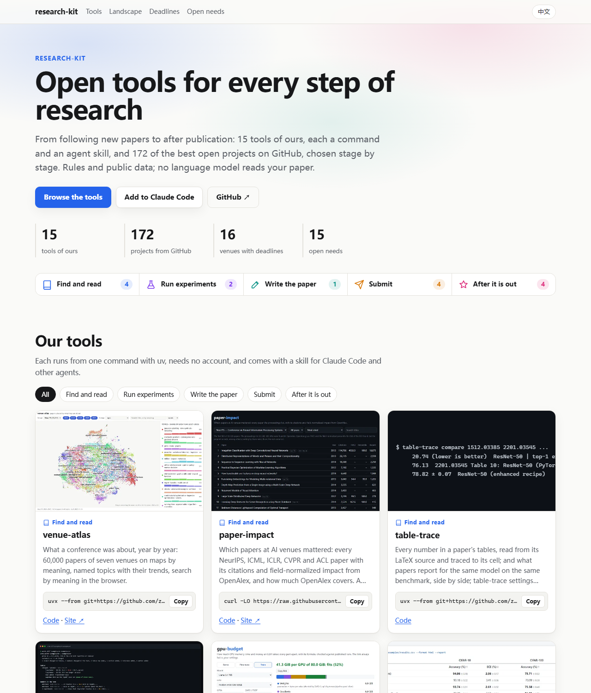

<div align="center">

# research-kit

**Open-source tools for every stage of research work, from following new papers to after publication.** Fifteen
of ours, each a command and an agent skill, and the best of the rest on GitHub, chosen stage by stage, with what
nothing covers yet. Ours run on rules and published data, without a large language model (venue-atlas places
papers with a small embedding model), and what they report says where it comes from.

<a href="LICENSE"></a>


**English** · [简体中文](README.zh-CN.md) · **[zch6a.github.io/research-kit](https://zch6a.github.io/research-kit/)**

</div>

---

<p align="center"><a href="https://zch6a.github.io/research-kit/"></a></p>

## Use them

**Our tools on their own**: each is the command under it below. They need [uv](https://docs.astral.sh/uv/) (it fetches
Python 3.10+ if needed); gpu-budget needs Node 22+. `@v0` in a command is the tool's latest release: a tag that moves
with each release (put a commit there instead for a fixed version).

**As agent skills**, in Claude Code: add the marketplace once, then install the tools you want by name (any of the
ones below):

```text
/plugin marketplace add zch6a/research-kit
/plugin install table-trace@research-kit
/plugin install paper-proof@research-kit
```

Each plugin is one tool's skill, from that tool's repository at `v0`: the agent runs the tool and quotes what it
found, with where it found it. Claude Code is only needed for the skills, not for the tools.

## Every stage of the work

Our tools first in each part (marked *ours*, with their command), then the other projects worth knowing, most
starred first.

<!-- tools:start -->
Stars, licences and update months of the other projects: GitHub API, 2026-11-14. A licence of "none" means the repository has no licence file: ask before reusing it.

### Find and read

#### Keeping up with new papers

**[arxiv-diff](https://github.com/zch6a/arxiv-diff)** (ours) — What changed between two versions of a paper: the result numbers in its tables by row and column, and the text, abstract, authors, figures and references. arxiv-diff watch tells you which arXiv papers in your .bib posted a new version.

```bash
uvx --from git+https://github.com/zch6a/arxiv-diff@v0 arxiv-diff 2106.09685
```

| Project | What it does | Stars | Licence | Updated |
|---|---|--:|---|---|
| [zotero-arxiv-daily](https://github.com/TideDra/zotero-arxiv-daily) | Emails you a daily list of new arXiv papers ranked by similarity to the papers already in your Zotero library, with LLM-written TL;DRs. | 6.2k | AGPL-3.0 | 2026-11 |
| [daily-arXiv-ai-enhanced](https://github.com/dw-dengwei/daily-arXiv-ai-enhanced) | Crawls chosen arXiv categories every day, summarises each paper with an LLM and publishes a browsable GitHub Pages site. | 3k | other | 2026-09 |
| [arxiv-sanity-lite](https://github.com/karpathy/arxiv-sanity-lite) | Self-hosted arXiv browser where you tag papers you like and get recommendations of similar new papers. | 1.7k | MIT | 2023-06 |
| [cv-arxiv-daily](https://github.com/Vincentqyw/cv-arxiv-daily) | Template that keeps a Markdown table of new arXiv papers per keyword, updated daily by GitHub Actions, with code links. | 1.5k | Apache-2.0 | 2026-11 |
| [agents-radar](https://github.com/duanyytop/agents-radar) | Daily AI ecosystem digest merging GitHub, arXiv, Hugging Face, Hacker News and other sources into one report. | 1.2k | MIT | 2026-11 |
| [daily-paper-reader](https://github.com/ziwenhahaha/daily-paper-reader) | Daily arXiv and OpenReview recommendations with AI reading and paper Q&A, deployed on GitHub Pages via Actions. | 979 | MIT | 2026-10 |
| [papers.cool](https://github.com/bojone/papers.cool) | Code for Cool Papers, a fast feed of new arXiv papers and conference proceedings with one-click LLM explanations (Kimi) per paper. | 820 | none | 2026-07 |
| [Wispar](https://github.com/Scriptbash/Wispar) | Mobile and desktop app that follows journals' table-of-contents feeds and new articles, with open-access lookup. | 226 | GPL-3.0 | 2026-11 |

#### Searching the literature

**[venue-atlas](https://github.com/zch6a/venue-atlas)** (ours) · [site](https://zch6a.github.io/venue-atlas/) — What a conference was about, year by year: 60,000 papers of seven venues on maps by meaning, named topics with their trends, search by meaning in the browser.

```bash
uvx --from git+https://github.com/zch6a/venue-atlas@v0 venue-atlas model    # the model, 30 MB, once
uvx --from git+https://github.com/zch6a/venue-atlas@v0 venue-atlas build iclr icml --out site
```

**[paper-impact](https://github.com/zch6a/paper-impact)** (ours) · [site](https://zch6a.github.io/paper-impact/) — Which papers at AI venues mattered: every NeurIPS, ICML, ICLR, CVPR and ACL paper with its citations and field-normalized impact from OpenAlex, and how much OpenAlex covers. A free OpenAlex key makes a full build days, not months.

```bash
curl -LO https://raw.githubusercontent.com/zch6a/paper-impact/v0/venues.json
uvx --from git+https://github.com/zch6a/paper-impact@v0 paper-impact build venues.json -o site/ --years 2024
```

| Project | What it does | Stars | Licence | Updated |
|---|---|--:|---|---|
| [arxiv-mcp-server](https://github.com/blazickjp/arxiv-mcp-server) | MCP server that lets an AI assistant search arXiv, read paper sections from the LaTeX source and fetch BibTeX. | 3.3k | Apache-2.0 | 2026-10 |
| [scholarly](https://github.com/scholarly-python-package/scholarly) | Fetches author profiles and publication data from Google Scholar from Python. | 1.9k | Unlicense | 2026-03 |
| [OpenScholar](https://github.com/AkariAsai/OpenScholar) | Retrieval-augmented LLM that answers scientific questions with citations drawn from a 45M-paper open corpus. | 1.7k | Apache-2.0 | 2025-08 |
| [pasa](https://github.com/bytedance/pasa) | LLM agent that runs searches, reads papers and follows citations on its own to answer a detailed literature query. | 1.7k | Apache-2.0 | 2025-05 |
| [arxiv.py](https://github.com/lukasschwab/arxiv.py) | Python wrapper for the arXiv API: query, page through results and download PDFs or source. | 1.6k | MIT | 2026-11 |
| [asreview](https://github.com/asreview/asreview) | Active-learning screening for systematic reviews: you label a few titles/abstracts, it ranks the rest by likely relevance. | 1.1k | Apache-2.0 | 2026-11 |
| [semanticscholar](https://github.com/danielnsilva/semanticscholar) | Python client for the Semantic Scholar APIs: paper and author search, citations, references and recommendations. | 485 | MIT | 2026-08 |
| [pyalex](https://github.com/J535D165/pyalex) | Python client for OpenAlex: works, authors, venues and citation links with filters and paging. | 432 | MIT | 2026-10 |
| [ai2-scholarqa-lib](https://github.com/allenai/ai2-scholarqa-lib) | Library and app behind Ai2 Scholar QA: multi-step search over Semantic Scholar that writes a sectioned, cited literature answer. | 289 | Apache-2.0 | 2026-10 |
| [LocalCitationNetwork.github.io](https://github.com/LocalCitationNetwork/LocalCitationNetwork.github.io) | Browser app that builds the citation network around a set of seed papers (OpenAlex, Semantic Scholar, Crossref) to find missing related work. | 150 | GPL-3.0 | 2026-05 |

#### Managing references

| Project | What it does | Stars | Licence | Updated |
|---|---|--:|---|---|
| [zotero](https://github.com/zotero/zotero) | Desktop reference manager that collects papers from the browser, stores PDFs, annotates and inserts citations into Word/LibreOffice. | 15.9k | other | 2026-11 |
| [jasminum](https://github.com/l0o0/jasminum) | Zotero plugin that fetches metadata for Chinese papers from CNKI and fixes Chinese name and attachment issues. | 7.4k | AGPL-3.0 | 2026-11 |
| [zotero-better-bibtex](https://github.com/retorquere/zotero-better-bibtex) | Zotero plugin that gives stable citation keys and keeps an auto-exported .bib file in sync for LaTeX. | 7.3k | MIT | 2026-11 |
| [zotero-mcp](https://github.com/54yyyu/zotero-mcp) | MCP server that lets AI assistants search, read and annotate your Zotero library, including semantic search. | 5.9k | MIT | 2026-11 |
| [jabref](https://github.com/JabRef/jabref) | Desktop manager that edits .bib/.biblatex files directly, with DOI/arXiv lookup, duplicate detection and citation-key patterns. | 4.9k | MIT | 2026-11 |
| [rebiber](https://github.com/yuchenlin/rebiber) | Replaces arXiv entries in a .bib file with their published versions from DBLP and the ACL Anthology. | 3k | MIT | 2026-11 |
| [papis](https://github.com/papis/papis) | Command-line document and bibliography manager that stores papers as plain folders with YAML metadata. | 1.8k | GPL-3.0 | 2026-11 |
| [bibtex-tidy](https://github.com/FlamingTempura/bibtex-tidy) | Cleans and formats BibTeX files: sorts, removes duplicates, normalises fields; CLI and web page. | 1.1k | MIT | 2026-10 |
| [zotero-format-metadata](https://github.com/northword/zotero-format-metadata) | Zotero plugin that lints and normalises item metadata: title case, journal abbreviations, languages, duplicates. | 1.1k | AGPL-3.0 | 2026-11 |
| [betterbib](https://github.com/texworld/betterbib) | Command-line tools that update .bib entries from Crossref/DBLP, fetch BibTeX from a DOI and sync fields. | 842 | none | 2026-11 |

#### Reading and taking notes

**[table-trace](https://github.com/zch6a/table-trace)** (ours) — Every number in a paper's tables, read from its LaTeX source and traced to its cell; and what papers report for the same model on the same benchmark, side by side; table-trace settings shows how each paper evaluated on a benchmark (shots, chain of thought, decoding, harness) and what differs.

```bash
uvx --from git+https://github.com/zch6a/table-trace@v0 table-trace compare 1512.03385 2201.03545 --row ResNet-50 --col top-1 --col acc
```

| Project | What it does | Stars | Licence | Updated |
|---|---|--:|---|---|
| [MinerU](https://github.com/opendatalab/MinerU) | Converts PDFs, including formulas and tables, into Markdown/JSON for reading in other tools or feeding to an LLM. | 83.6k | other | 2026-11 |
| [gpt_academic](https://github.com/binary-husky/gpt_academic) | LLM workbench with one-click paper actions: full-text PDF/LaTeX translation, summarisation, polishing and arXiv paper reading. | 71.7k | GPL-3.0 | 2026-01 |
| [open-notebook](https://github.com/lfnovo/open-notebook) | Self-hosted NotebookLM alternative: add papers and sources, chat with them, take notes, make audio overviews. | 41.9k | MIT | 2026-11 |
| [PDFMathTranslate](https://github.com/PDFMathTranslate/PDFMathTranslate) | Translates scientific PDFs while keeping formulas, figures and layout, outputting a translated or side-by-side bilingual PDF. | 38.4k | AGPL-3.0 | 2026-11 |
| [zotero-pdf-translate](https://github.com/windingwind/zotero-pdf-translate) | Zotero plugin that translates selected text, annotations, titles and abstracts with 20+ engines while reading. | 12.3k | AGPL-3.0 | 2026-11 |
| [sioyek](https://github.com/ahrm/sioyek) | Keyboard-driven PDF viewer for papers: previews references and figures on hover, smart jump, portals and searchable highlights. | 10k | GPL-3.0 | 2026-11 |
| [paper-qa](https://github.com/Future-House/paper-qa) | Answers questions over a folder of papers with retrieval and cited, checked answers (PaperQA2). | 9.6k | Apache-2.0 | 2026-11 |
| [zotero-better-notes](https://github.com/windingwind/zotero-better-notes) | Zotero plugin for linked notes, note templates, outlines and syncing notes to Markdown. | 8.5k | AGPL-3.0 | 2026-11 |
| [zotero-pdf2zh](https://github.com/guaguastandup/zotero-pdf2zh) | Zotero plugin that runs PDFMathTranslate on a paper and attaches the bilingual PDF back to the item. | 8.3k | AGPL-3.0 | 2026-11 |
| [zotero-gpt](https://github.com/MuiseDestiny/zotero-gpt) | Zotero plugin to chat with the open PDF or selected items using an LLM, and to summarise or tag them. | 7.5k | AGPL-3.0 | 2026-10 |
| [grobid](https://github.com/grobidOrg/grobid) | Extracts header metadata, sections and a parsed reference list from scholarly PDFs into TEI XML. | 5.2k | Apache-2.0 | 2026-11 |

#### AI research assistants

| Project | What it does | Stars | Licence | Updated |
|---|---|--:|---|---|
| [autoresearch](https://github.com/karpathy/autoresearch) | Lets coding agents run many small single-GPU training experiments overnight and keep what improves the metric. | 100k | none | 2026-03 |
| [deer-flow](https://github.com/bytedance/deer-flow) | Multi-agent harness that searches, runs code in a sandbox and writes reports for long research tasks. | 85.3k | MIT | 2026-11 |
| [storm](https://github.com/stanford-oval/storm) | Researches a topic and writes a Wikipedia-style survey article with citations, useful as a first map of an unfamiliar area. | 31.9k | MIT | 2025-09 |
| [gpt-researcher](https://github.com/assafelovic/gpt-researcher) | Deep-research agent that searches the web or your own documents and writes a cited report with any LLM provider. | 30.7k | Apache-2.0 | 2026-11 |
| [AI-Scientist-v2](https://github.com/SakanaAI/AI-Scientist-v2) | End-to-end 'AI scientist': proposes ideas, runs experiments via agentic tree search, and drafts a workshop-style paper. | 7.5k | other | 2025-12 |

### Run experiments

#### Running and tracking experiments

| Project | What it does | Stars | Licence | Updated |
|---|---|--:|---|---|
| [ray](https://github.com/ray-project/ray) | Distributed compute framework whose Ray Tune module runs hyperparameter searches in parallel across GPUs and nodes. | 44.3k | Apache-2.0 | 2026-11 |
| [mlflow](https://github.com/mlflow/mlflow) | Logs parameters, metrics and artifacts of each run to a local or self-hosted server and lets you compare runs in a web UI. | 28.8k | Apache-2.0 | 2026-11 |
| [optuna](https://github.com/optuna/optuna) | Hyperparameter search with pruning of bad trials, a define-by-run API and a dashboard for studies. | 15k | MIT | 2026-11 |
| [hydra](https://github.com/hydra-ecosystem/hydra) | Composes experiment configs from YAML files and command-line overrides, and launches sweeps over them. | 10.7k | MIT | 2026-11 |
| [cookiecutter-data-science](https://github.com/drivendataorg/cookiecutter-data-science) | Generates a standard folder layout for a data-science or research project so data, code and results stay separated. | 10.1k | MIT | 2026-11 |
| [clearml](https://github.com/clearml/clearml) | Tracks experiments automatically and adds a task queue and agents so runs can be cloned and re-run on other machines. | 6.9k | Apache-2.0 | 2026-11 |
| [aim](https://github.com/aimhubio/aim) | Self-hosted experiment tracker with a fast UI for querying and comparing thousands of runs and their metric curves. | 6.3k | Apache-2.0 | 2026-11 |
| [lightning-hydra-template](https://github.com/ashleve/lightning-hydra-template) | Project template combining PyTorch Lightning and Hydra with logging, testing and experiment-config conventions. | 5.4k | none | 2026-06 |
| [SwanLab](https://github.com/SwanHubX/SwanLab) | Lightweight experiment tracker with a W&B-like API, offline or self-hosted dashboard, popular with Chinese labs. | 4.4k | Apache-2.0 | 2026-11 |
| [trackio](https://github.com/gradio-app/trackio) | Drop-in replacement for the wandb logging API that stores runs locally and can show the dashboard on a Hugging Face Space. | 1.8k | MIT | 2026-11 |

#### Compute and environments

**[gpu-budget](https://github.com/zch6a/gpu-budget)** (ours) · [site](https://zch6a.github.io/gpu-budget/) — How much GPU memory, time and money training, fine-tuning or serving an LLM takes, each part with its formula (ZeRO/FSDP, parallelism, MoE, LoRA/QLoRA, KV cache), checked against published runs.

```bash
npx github:zch6a/gpu-budget#v0 train llama-3.1-70b --gpus 64 --zero 3 --tokens 2e12 --price 2.5
```

| Project | What it does | Stars | Licence | Updated |
|---|---|--:|---|---|
| [uv](https://github.com/astral-sh/uv) | Very fast Python package and environment manager with lockfiles, making research environments quick to recreate. | 92k | Apache-2.0 | 2026-11 |
| [nvtop](https://github.com/Syllo/nvtop) | htop-like GPU monitor that works for NVIDIA, AMD, Intel and Apple GPUs. | 11.2k | other | 2026-11 |
| [skypilot](https://github.com/skypilot-org/skypilot) | Runs the same job YAML on any cloud, Kubernetes or Slurm cluster, picking the cheapest available GPUs and using spot instances. | 10.8k | Apache-2.0 | 2026-11 |
| [pixi](https://github.com/prefix-dev/pixi) | Conda-ecosystem package manager with per-project lockfiles, covering CUDA and non-Python dependencies. | 8k | BSD-3-Clause | 2026-11 |
| [nvitop](https://github.com/XuehaiPan/nvitop) | Interactive GPU process viewer showing per-process memory, utilisation and owner, also usable as a Python library. | 7.3k | Apache-2.0 | 2026-11 |
| [slurm](https://github.com/SchedMD/slurm) | The batch job scheduler used on most university and national HPC clusters. | 4.5k | other | 2026-11 |
| [gpustat](https://github.com/wookayin/gpustat) | One-line-per-GPU status of memory, utilisation and users, handy for scripts and checking who is using a shared box. | 4.4k | MIT | 2026-10 |
| [dstack](https://github.com/dstackai/dstack) | Open-source orchestrator for dev environments, training jobs and services on clouds and on-prem GPU fleets. | 2.3k | MPL-2.0 | 2026-11 |
| [apptainer](https://github.com/apptainer/apptainer) | Container runtime (formerly Singularity) that runs images without root, the usual way to use containers on HPC clusters. | 2k | other | 2026-11 |
| [submitit](https://github.com/facebookincubator/submitit) | Submits Python functions as Slurm jobs and returns results like futures, so sweeps run on a cluster from plain Python. | 1.6k | MIT | 2026-11 |
| [task-spooler](https://github.com/justanhduc/task-spooler) | A job queue for one machine: commands wait their turn and each gets free GPUs (ts -G). | 448 | GPL-2.0 | 2024-03 |

#### Data and evaluation

**[exp-tables](https://github.com/zch6a/exp-tables)** (ours) — Experiment results to your paper's table: mean ± spread over seeds, significance against the best, bold only where the seeds support it; from CSV, wandb, TensorBoard or MLflow.

```bash
uvx --from git+https://github.com/zch6a/exp-tables@v0 exp-tables results.csv --format markdown
```

| Project | What it does | Stars | Licence | Updated |
|---|---|--:|---|---|
| [label-studio](https://github.com/HumanSignal/label-studio) | Self-hosted labelling tool for text, images, audio, video and LLM outputs with configurable annotation interfaces. | 28.7k | Apache-2.0 | 2026-11 |
| [cvat](https://github.com/cvat-ai/cvat) | Annotation tool for images and video (boxes, polygons, tracks) with model-assisted labelling. | 17.1k | MIT | 2026-11 |
| [dvc](https://github.com/treeverse/dvc) | Versions large datasets and models alongside Git and defines reproducible pipelines from data to metrics. | 16k | Apache-2.0 | 2026-11 |
| [lm-evaluation-harness](https://github.com/EleutherAI/lm-evaluation-harness) | Runs language models on hundreds of standard benchmarks with fixed prompts so scores are comparable across papers. | 14.5k | MIT | 2026-11 |
| [opencompass](https://github.com/open-compass/opencompass) | Evaluation platform covering many Chinese and English benchmarks for LLMs and multimodal models. | 7.6k | Apache-2.0 | 2026-11 |
| [inspect_ai](https://github.com/UKGovernmentBEIS/inspect_ai) | Framework for writing LLM and agent evaluations with solvers, tools, sandboxes and a log viewer. | 3.2k | MIT | 2026-11 |
| [helm](https://github.com/stanford-crfm/helm) | Holistic evaluation of language models over many scenarios and metrics beyond accuracy, with a public leaderboard. | 3k | Apache-2.0 | 2026-09 |
| [lighteval](https://github.com/huggingface/lighteval) | Fast LLM evaluation across several inference backends, with per-sample results saved for inspection. | 2.6k | MIT | 2026-11 |
| [scikit-posthocs](https://github.com/maximtrp/scikit-posthocs) | Post-hoc tests (Nemenyi, Conover, Dunn...) and critical-difference plots for comparing many methods over many datasets. | 392 | MIT | 2026-11 |
| [deep-significance](https://github.com/Kaleidophon/deep-significance) | Significance tests for comparing deep-learning models over seeds, including Almost Stochastic Order and multiple-comparison correction. | 343 | GPL-3.0 | 2026-09 |

### Write the paper

#### Writing and typesetting

| Project | What it does | Stars | Licence | Updated |
|---|---|--:|---|---|
| [typst](https://github.com/typst/typst) | Modern typesetting system with simple markup and fast incremental compiles; a growing alternative to LaTeX for papers and theses. | 57.2k | Apache-2.0 | 2026-11 |
| [pandoc](https://github.com/jgm/pandoc) | Universal document converter: Markdown, LaTeX, Word, HTML and more, with citeproc for references. | 46.9k | GPL-2.0 | 2026-11 |
| [overleaf](https://github.com/overleaf/overleaf) | Source of the Overleaf collaborative LaTeX editor, so a lab can self-host it (Community Edition). | 18.3k | AGPL-3.0 | 2026-09 |
| [LaTeX-Workshop](https://github.com/James-Yu/LaTeX-Workshop) | VS Code extension for LaTeX: build, PDF preview with SyncTeX, autocompletion and linting. | 12.4k | MIT | 2026-11 |
| [quarto-cli](https://github.com/quarto-dev/quarto-cli) | Pandoc-based publishing system that turns Markdown/notebooks with live code into PDFs, journal formats and websites. | 6.2k | other | 2026-11 |
| [thuthesis](https://github.com/tuna/thuthesis) | Tsinghua University LaTeX thesis template, a model for the many Chinese university thesis templates. | 5.5k | LPPL-1.3c | 2026-08 |
| [tectonic](https://github.com/tectonic-typesetting/tectonic) | Self-contained TeX engine that fetches packages on demand, so papers build reproducibly without a full TeX Live install. | 5.2k | other | 2026-08 |
| [texstudio](https://github.com/texstudio-org/texstudio) | Desktop LaTeX editor with built-in PDF viewer, completion, and structure view. | 3.7k | GPL-3.0 | 2026-11 |
| [acl-style-files](https://github.com/acl-org/acl-style-files) | Official LaTeX style files for ACL-family venues (ACL, EMNLP, NAACL, ...). | 2.1k | none | 2026-06 |

#### Checking the text

| Project | What it does | Stars | Licence | Updated |
|---|---|--:|---|---|
| [awesome-ai-research-writing](https://github.com/Leey21/awesome-ai-research-writing) (a list) | Curated prompts and workflows for using LLMs to polish, translate and check research papers. | 35.9k | none | 2026-08 |
| [languagetool](https://github.com/languagetool-org/languagetool) | Open-source grammar, style and spelling checker for 25+ languages; can run as a local server. | 15.3k | LGPL-2.1 | 2026-11 |
| [vale](https://github.com/vale-cli/vale) | Markup-aware prose linter with configurable style rules (e.g. weasel words, passive voice). | 6.4k | MIT | 2026-11 |
| [Paper-Writing-Tips](https://github.com/MLNLP-World/Paper-Writing-Tips) (a list) | Checklist of common small mistakes in ML/NLP paper writing and submission (Chinese and English). | 4.7k | none | 2026-09 |
| [paperdebugger](https://github.com/PaperDebugger/paperdebugger) | Overleaf plugin with LLM agents that review and suggest edits inside the editor. | 1.6k | AGPL-3.0 | 2026-07 |
| [latexindent.pl](https://github.com/cmhughes/latexindent.pl) | Formats LaTeX source (indentation, line breaks, one sentence per line) for cleaner diffs and co-authoring. | 1.1k | GPL-3.0 | 2026-11 |
| [textidote](https://github.com/sylvainhalle/textidote) | Spelling, grammar and style checks on LaTeX source with errors mapped back to the original lines. | 1.1k | GPL-3.0 | 2026-09 |
| [latexdiff](https://github.com/ftilmann/latexdiff) | Marks up the differences between two LaTeX versions as a compiled PDF, e.g. for rebuttal 'changes' files. | 680 | GPL-3.0 | 2026-10 |
| [ltex-ls-plus](https://github.com/ltex-plus/ltex-ls-plus) | Language server that runs LanguageTool on LaTeX and Markdown in your editor, skipping commands and math. | 263 | MPL-2.0 | 2026-11 |

#### Figures and diagrams

**[fig-check](https://github.com/zch6a/fig-check)** (ours) — A paper's figures as they will print: text size at the printed scale, colours that collapse for colour-blind readers, raster resolution; for every figure of a LaTeX project. paper_style makes matplotlib figures at the column width, in the paper's font.

```bash
uvx --from git+https://github.com/zch6a/fig-check@v0 fig-check paper/
```

| Project | What it does | Stars | Licence | Updated |
|---|---|--:|---|---|
| [excalidraw](https://github.com/excalidraw/excalidraw) | Whiteboard for quick hand-drawn-style diagrams, often used for teaser and overview figures. | 135k | MIT | 2026-11 |
| [drawio-desktop](https://github.com/jgraph/drawio-desktop) | Desktop draw.io for pipeline and system diagrams, exporting vector PDF/SVG. | 64k | GPL-3.0 | 2026-11 |
| [PlotNeuralNet](https://github.com/HarisIqbal88/PlotNeuralNet) | LaTeX/TikZ code for drawing CNN-style neural network architecture diagrams. | 25.1k | MIT | 2023-08 |
| [scientific-visualization-book](https://github.com/rougier/scientific-visualization-book) | Open-access book with code on making clear scientific figures in Matplotlib. | 11.7k | other | 2026-01 |
| [SciencePlots](https://github.com/garrettj403/SciencePlots) | Matplotlib styles for journal and conference figures (IEEE, Nature, high-contrast and colour-blind-safe palettes). | 9.4k | MIT | 2026-06 |
| [PaperBanana](https://github.com/dwzhu-pku/PaperBanana) | Agent pipeline that generates academic method diagrams and plots from a paper's text. | 7.6k | Apache-2.0 | 2026-11 |
| [NN-SVG](https://github.com/alexlenail/NN-SVG) | Web tool that draws FCNN, LeNet- and AlexNet-style architecture schematics and exports SVG. | 5.7k | MIT | 2026-06 |
| [pgf](https://github.com/pgf-tikz/pgf) | Source of PGF/TikZ, the LaTeX graphics language used for most hand-built diagrams in papers (pgfplots lives alongside). | 1.4k | none | 2026-11 |
| [torchview](https://github.com/mert-kurttutan/torchview) | Draws the actual graph of a PyTorch model (layers, shapes) with Graphviz. | 1.1k | MIT | 2026-02 |
| [CMasher](https://github.com/1313e/CMasher) | Perceptually uniform, colour-blind-friendly colormaps for Matplotlib. | 500 | BSD-3-Clause | 2026-10 |

### Submit

#### Checking before submission

**[paper-proof](https://github.com/zch6a/paper-proof)** (ours) — Check your paper before reviewers do: invented or wrong references, bold results that are not the best, claimed gains that do not add up, stale abstract numbers, broken labels, and the paper against itself (an acronym spelled out two ways, one term written two ways), and style slips seen through the LaTeX (a word twice, a/an, Figure~\ref). With --review, points for a reviewer to check in a submitted PDF, sending nothing.

```bash
uvx --from git+https://github.com/zch6a/paper-proof@v0 paper-proof path/to/paper
```

**[submit-check](https://github.com/zch6a/submit-check)** (ours) — Don't get desk-rejected for a slip: a LaTeX paper checked against the venue's rules (double-blind leaks, template mode, page limit, required sections, PDF fonts, leftover TODOs), the supplementary zip checked for names, paths, .git and file metadata, and a camera-ready for what the review version left behind.

```bash
uvx --from git+https://github.com/zch6a/submit-check@v0 submit-check path/to/paper
```

| Project | What it does | Stars | Licence | Updated |
|---|---|--:|---|---|
| [arxiv-latex-cleaner](https://github.com/google-research/arxiv-latex-cleaner) | Strips comments, unused files and oversized images from a LaTeX project so it can be uploaded to arXiv without leaking drafts. | 7.1k | Apache-2.0 | 2026-11 |
| [aclpubcheck](https://github.com/acl-org/aclpubcheck) | Checks an ACL-style PDF for margin overflows, page limits, fonts and paper size, and flags bad references. | 1.1k | MIT | 2026-11 |
| [refchecker](https://github.com/markrussinovich/refchecker) | Checks each reference of a paper against Semantic Scholar, OpenAlex and arXiv and reports wrong authors, years, venues or references that do not exist. | 569 | MIT | 2026-10 |
| [arxiv-collector](https://github.com/djsutherland/arxiv-collector) | Uses latexmk's dependency list to collect exactly the files a paper needs into an arXiv-ready archive, including the .bbl. | 385 | BSD-3-Clause | 2025-07 |
| [citegate](https://github.com/chrisyangsong/citegate) | Runs BibTeX verification against Crossref and OpenAlex as a CI step, failing the build on hallucinated or mismatched entries. | 101 | MIT | 2026-08 |
| [Paper-Linter](https://github.com/misc0110/Paper-Linter) | Scans paper LaTeX for common mistakes such as wrong spacing before citations, inconsistent capitalisation and misused abbreviations. | 35 | MIT | 2026-08 |

#### Deadlines and submission

| Project | What it does | Stars | Licence | Updated |
|---|---|--:|---|---|
| [ccf-deadlines](https://github.com/ccfddl/ccf-deadlines) | Community-maintained deadlines of CCF-ranked and other CS conferences, with a website, CLI and WeChat mini-program. | 9.5k | MIT | 2026-11 |
| [ai-deadlines](https://github.com/paperswithcode/ai-deadlines) | The original AI deadline countdown site that many forks and field-specific trackers copy. | 6k | MIT | 2024-09 |
| [anonymous_github](https://github.com/tdurieux/anonymous_github) | Serves an anonymised, read-only copy of a GitHub repository for double-blind review, hiding names in files and history. | 2.3k | GPL-3.0 | 2026-11 |
| [sec-deadlines.github.io](https://github.com/sec-deadlines/sec-deadlines.github.io) | Deadline countdowns for security and privacy conferences. | 875 | none | 2026-11 |
| [hotcrp](https://github.com/kohler/hotcrp) | Self-hosted conference review system for submissions, reviewer assignment, reviews and author responses. | 442 | other | 2026-11 |
| [ai-deadlines](https://github.com/huggingface/ai-deadlines) | Countdowns to AI conference deadlines, the maintained continuation of the Papers with Code list. | 351 | MIT | 2026-09 |
| [openreview-py](https://github.com/openreview/openreview-py) | Official Python client for OpenReview: fetch submissions, reviews and decisions, or script venue workflows. | 273 | MIT | 2026-11 |

#### Peer review and rebuttal

**[iclr-scores](https://github.com/zch6a/iclr-scores)** (ours) · [site](https://zch6a.github.io/iclr-scores/) — What ICLR's review scores led to, 2017-2025: the acceptance rate by mean score, where half the papers got in, what disagreement did, and the odds for your scores.

```bash
uvx --from git+https://github.com/zch6a/iclr-scores@v0 iclr-scores odds 6 6 8 5 --year 2025
```

**[rebuttal-board](https://github.com/zch6a/rebuttal-board)** (ours) — A rebuttal tracked point by point: reviews pasted from OpenReview or CMT split into points, a Markdown tracker with each point's status, experiment and answer, each reply's length against the limit, and score changes. Offline.

```bash
uvx --from git+https://github.com/zch6a/rebuttal-board@v0 rebuttal init reviews.txt
```

| Project | What it does | Stars | Licence | Updated |
|---|---|--:|---|---|
| [paperlists](https://github.com/papercopilot/paperlists) | Cleaned per-venue lists of submissions with review scores and decisions, collected from OpenReview and other sources. | 967 | none | 2026-11 |
| [AgentReview](https://github.com/Ahren09/AgentReview) | Simulates reviewers, authors and area chairs with LLM agents to study biases in the review process. | 718 | Apache-2.0 | 2026-05 |
| [Paper2Rebuttal](https://github.com/AutoLab-SAI-SJTU/Paper2Rebuttal) | Multi-agent system that reads the paper and reviews, plans responses point by point and drafts a rebuttal. | 565 | none | 2026-08 |
| [Rebuttal-Skill](https://github.com/TobiasLee/Rebuttal-Skill) | Agent skill that guides a coding agent through structured rebuttal writing. | 507 | none | 2026-11 |
| [Paper-Rebuttal-Tips](https://github.com/MLNLP-World/Paper-Rebuttal-Tips) (a list) | List: collected advice and examples for writing rebuttals, from the Chinese MLNLP community. | 436 | none | 2026-10 |
| [PeerRead](https://github.com/allenai/PeerRead) | Dataset of papers with peer reviews and accept/reject labels, plus baseline code for review research. | 432 | none | 2025-12 |
| [Researcher](https://github.com/zhu-minjun/Researcher) | Includes DeepReviewer, an open model that writes structured reviews and scores for ML papers. | 409 | other | 2026-03 |
| [cv_rebuttal_template](https://github.com/guanyingc/cv_rebuttal_template) | LaTeX templates for one-page CVPR/ICCV-style rebuttals with compact layouts. | 308 | none | 2024-05 |
| [RebuttalStudio](https://github.com/runtsang/RebuttalStudio) | Editor for writing rebuttals: organise reviewer points, draft answers and keep within length limits. | 225 | none | 2026-04 |
| [openreview-expertise](https://github.com/openreview/openreview-expertise) | Computes reviewer-paper affinity scores from reviewers' past papers for the OpenReview matching system. | 51 | MIT | 2026-11 |

### After it is out

#### Releasing code and data

**[repro-score](https://github.com/zch6a/repro-score)** (ours) — Can someone reproduce your paper from your code? A score out of 100 for a research code repository, item by item with the file and line behind it, read from the files with nothing run; repro-score release checks that the version, tags, CITATION.cff and DOIs agree.

```bash
uvx --from git+https://github.com/zch6a/repro-score@v0 repro-score github:owner/repo
```

| Project | What it does | Stars | Licence | Updated |
|---|---|--:|---|---|
| [huggingface_hub](https://github.com/huggingface/huggingface_hub) | Uploads model weights, datasets and model/dataset cards to the Hugging Face Hub from Python or the command line. | 4k | Apache-2.0 | 2026-11 |
| [releasing-research-code](https://github.com/paperswithcode/releasing-research-code) (a list) | Guide and README template for releasing ML code, the basis of the NeurIPS code submission checklist. | 3k | MIT | 2023-05 |
| [binderhub](https://github.com/jupyterhub/binderhub) | Powers mybinder.org, letting readers open a paper's notebooks in the browser from a single link. | 2.7k | BSD-3-Clause | 2026-11 |
| [repo2docker](https://github.com/jupyterhub/repo2docker) | Builds a runnable container from a repository's requirements or environment files without writing a Dockerfile. | 1.7k | BSD-3-Clause | 2026-11 |
| [croissant](https://github.com/mlcommons/croissant) | Metadata format and tools for describing ML datasets, required for the NeurIPS Datasets and Benchmarks track. | 921 | Apache-2.0 | 2026-11 |
| [osf.io](https://github.com/CenterForOpenScience/osf.io) | Source of the Open Science Framework for preregistration, project files, preprints and DOIs. | 730 | Apache-2.0 | 2026-11 |
| [datalad](https://github.com/datalad/datalad) | Version-controls and publishes datasets with git-annex and records which command produced each output for re-running. | 677 | other | 2026-11 |
| [citation-file-format](https://github.com/citation-file-format/citation-file-format) | Spec for CITATION.cff, which makes GitHub, Zenodo and Zotero show a correct citation for a repository. | 562 | CC-BY-4.0 | 2026-09 |
| [reprozip](https://github.com/VIDA-NYU/reprozip) | Traces a command's run and packs all files and libraries it used into a bundle others can replay. | 364 | BSD-3-Clause | 2026-02 |
| [zenodo-rdm](https://github.com/zenodo/zenodo-rdm) | Source of Zenodo, which archives code, data and artefacts with a DOI and mints one per GitHub release. | 351 | GPL-3.0 | 2026-11 |

#### Project pages and homepages

**[paper-page](https://github.com/zch6a/paper-page)** (ours) · [site](https://zch6a.github.io/paper-page/) — A project page for your paper from its arXiv id: links, teaser, abstract, BibTeX, Google Scholar and link-preview tags, in one static HTML file for GitHub Pages.

```bash
uvx --from git+https://github.com/zch6a/paper-page@v0 paper-page new 2003.08934 -o page/
```

| Project | What it does | Stars | Licence | Updated |
|---|---|--:|---|---|
| [academicpages.github.io](https://github.com/academicpages/academicpages.github.io) | GitHub Pages template for a personal academic site with publications, talks, teaching and CV pages. | 17.8k | MIT | 2026-11 |
| [al-folio](https://github.com/alshedivat/al-folio) | Jekyll theme for academics with BibTeX-driven publication lists, project pages, blog and CV. | 16.3k | MIT | 2026-11 |
| [Academic-project-page-template](https://github.com/eliahuhorwitz/Academic-project-page-template) | Fill-in-the-blanks HTML template for a paper's project page with teaser video, abstract, figures, poster and BibTeX. | 5.3k | none | 2025-09 |
| [hugo-theme-academic-cv](https://github.com/HugoBlox/hugo-theme-academic-cv) | Hugo template (formerly Wowchemy/Hugo Academic) for an academic portfolio with BibTeX import. | 5.1k | MIT | 2026-11 |
| [nerfies.github.io](https://github.com/nerfies/nerfies.github.io) | The Nerfies project page that most ML paper pages are copied from. | 4.4k | none | 2024-06 |
| [jonbarron.github.io](https://github.com/jonbarron/jonbarron.github.io) | Jon Barron's plain HTML homepage, the source of the widely copied one-page researcher layout. | 3.7k | none | 2026-11 |
| [acad-homepage.github.io](https://github.com/RayeRen/acad-homepage.github.io) | Single-page academic homepage template with automatic Google Scholar citation counts. | 3k | MIT | 2026-09 |
| [jekyll-scholar](https://github.com/inukshuk/jekyll-scholar) | Jekyll plugin that renders publication lists and citations from BibTeX. | 1.2k | MIT | 2026-01 |
| [minimal-light](https://github.com/yaoyao-liu/minimal-light) | Minimal Jekyll theme for an academic homepage with a publication list. | 1.1k | CC0-1.0 | 2026-10 |
| [academic-homepage](https://github.com/luost26/academic-homepage) | GitHub Pages template for an academic homepage with publication data kept in YAML. | 731 | MIT | 2026-10 |
| [academic-project-astro-template](https://github.com/RomanHauksson/academic-project-astro-template) | Astro rebuild of the Nerfies page where content is written in Markdown/MDX with components for figures and videos. | 558 | none | 2026-06 |
| [paper2anything](https://github.com/QuZhan51496/paper2anything) | Agent skills that turn a paper PDF into a web page, slides, a poster and social posts. | 485 | Apache-2.0 | 2026-07 |
| [academic-project-page-template-vue](https://github.com/JunyaoHu/academic-project-page-template-vue) | Vue-based project page template driven by a config file. | 336 | none | 2025-07 |

#### Posters, slides and talks

| Project | What it does | Stars | Licence | Updated |
|---|---|--:|---|---|
| [reveal.js](https://github.com/hakimel/reveal.js) | HTML presentation framework used underneath many Markdown and Quarto slide tools. | 72.6k | MIT | 2026-09 |
| [slidev](https://github.com/slidevjs/slidev) | Markdown slides with live code, LaTeX math and Vue components, exported to PDF. | 49.5k | MIT | 2026-11 |
| [marp](https://github.com/marp-team/marp) | Writes slides in plain Markdown and exports them to PDF, HTML or PowerPoint. | 12.7k | MIT | 2026-11 |
| [mtheme](https://github.com/matze/mtheme) | Metropolis, a clean modern Beamer theme. | 6.9k | none | 2022-11 |
| [Paper2Poster](https://github.com/Paper2Poster/Paper2Poster) | Multi-agent system that generates an editable poster from a paper PDF. | 4.1k | MIT | 2026-11 |
| [Paper2Slides](https://github.com/HKUDS/Paper2Slides) | Generates a slide deck from a paper in one step. | 3.9k | MIT | 2026-05 |
| [touying](https://github.com/touying-typ/touying) | Slide framework for Typst with themes and animations, compiling much faster than Beamer. | 2.4k | MIT | 2026-11 |
| [Paper2Video](https://github.com/showlab/Paper2Video) | Generates a presentation video with slides, subtitles and a talking presenter from a paper. | 2.4k | MIT | 2026-03 |
| [ultimate-beamer-theme-list](https://github.com/martinbjeldbak/ultimate-beamer-theme-list) (a list) | List: screenshots and links of community Beamer themes, including many university themes. | 1.8k | none | 2026-11 |
| [beamer](https://github.com/josephwright/beamer) | The Beamer LaTeX class for slides, the default for math-heavy talks. | 1.7k | other | 2026-08 |
| [gemini](https://github.com/anishathalye/gemini) | Clean beamerposter theme for LaTeX conference posters. | 1.3k | MIT | 2026-11 |
| [posterdown](https://github.com/brentthorne/posterdown) | Writes conference posters in R Markdown and renders them to PDF through HTML. | 882 | other | 2021-12 |
| [posterly](https://github.com/Chenruishuo/posterly) | Builds a poster as one HTML/CSS file and prints it to a PDF of the right size with a headless browser. | 440 | AGPL-3.0 | 2026-11 |
| [latex-beamerposter](https://github.com/deselaers/latex-beamerposter) | The beamerposter package that lets Beamer themes be used for large-format posters. | 436 | GPL-2.0 | 2021-12 |
| [betterposter-latex-template](https://github.com/rafaelbailo/betterposter-latex-template) | LaTeX version of Mike Morrison's #betterposter layout with one large central finding. | 326 | GPL-3.0 | 2019-09 |
| [peace-of-posters](https://github.com/jonaspleyer/peace-of-posters) | Typst package for scientific posters with themes and layout boxes. | 123 | MIT | 2026-09 |

#### Sharing and tracking citations

**[scholar-cards](https://github.com/zch6a/scholar-cards)** (ours) — Your citations, h-index and most cited papers from OpenAlex as SVG cards for an academic homepage or a GitHub profile, kept fresh by a GitHub Action; no API key; scholar-cards cited lists who cites a paper and what they say, new citations first.

```bash
uvx --from git+https://github.com/zch6a/scholar-cards@v0 scholar-cards search "Your Name"
```

| Project | What it does | Stars | Licence | Updated |
|---|---|--:|---|---|
| [AutoPR](https://github.com/LightChen233/AutoPR) | Research code that turns a paper into platform-specific promotion posts and evaluates them. | 103 | MIT | 2025-10 |
| [Scholar-Citation-Monitor](https://github.com/DreamH1gh/Scholar-Citation-Monitor) | Browser extension that watches Google Scholar citation counts and notes changes. | 78 | none | 2026-07 |

#### Lab websites, reading groups, teaching

**[reading-group](https://github.com/zch6a/reading-group)** (ours) · [site](https://zch6a.github.io/reading-group/) — A reading group run from one GitHub repository: papers suggested as issues and voted with a thumbs-up, the schedule and notes in the repository, a page and a calendar built by a GitHub Action.

```bash
uvx --from git+https://github.com/zch6a/reading-group@v0 reading-group next --repo OWNER/NAME
```

| Project | What it does | Stars | Licence | Updated |
|---|---|--:|---|---|
| [jupyter-book](https://github.com/jupyter-book/jupyter-book) | Builds course notes and books from Markdown and notebooks, with executable code. | 4.3k | BSD-3-Clause | 2026-11 |
| [h](https://github.com/hypothesis/h) | Server behind Hypothesis web annotation, letting a reading group annotate papers together in private groups. | 3.2k | BSD-2-Clause | 2026-11 |
| [nbgrader](https://github.com/jupyter/nbgrader) | Creates, distributes and grades notebook assignments. | 1.4k | BSD-3-Clause | 2026-11 |
| [lab-website-template](https://github.com/greenelab/lab-website-template) | Jekyll lab website template that builds the publication list automatically from DOIs, ORCID and other identifiers. | 582 | BSD-3-Clause | 2026-11 |
| [theme-research-group](https://github.com/HugoBlox/theme-research-group) | Hugo template for a research group site with people, publications, news and events. | 403 | MIT | 2024-10 |
<!-- tools:end -->

## Deadlines and venue rules

<!-- deadlines:start -->
| Venue | Next deadline | Time zone | Conference | Pages (camera-ready); required | Rules |
|---|---|---|---|---|---|
| [CVPR 2027](https://cvpr.thecvf.com/Conferences/2027) | abstract 2026-11-10, paper 2026-11-16 23:59 | UTC-12 | June 22-25, 2027, Seattle, WA, United States | 8 pages | [`--venue cvpr2026`](https://cvpr.thecvf.com/Conferences/2026/AuthorGuidelines) |
| [NAACL 2027](https://2027.naacl.org/) | 2026-12-23 23:59 (NAACL commitment after ARR meta-reviews; reviewed papers only) | UTC-12 | June 1-5, 2027, San Francisco, California, USA | 8 pages; requires a section titled Limitations | [`--venue acl-arr`](https://aclrollingreview.org/cfp) |
| [ACL 2027](https://2027.aclweb.org/) | 2027-01-04 23:59 (ARR Submission) | UTC-12 | August 20-22, 2027, Kyoto, Japan | 8 pages; requires a section titled Limitations | [`--venue acl-arr`](https://aclrollingreview.org/cfp) |
| [IJCAI 2027](https://2027.ijcai.org/) | abstract 2027-01-04, paper 2027-01-11 23:59 (Separate satellite event: August 15-17, 2027, Hengqin, China) | AoE | August 7-13, 2027, Kyoto, Japan | 7 pages | [`--venue ijcai2026`](https://2026.ijcai.org/ijcai-ecai-2026-call-for-papers-main-track/) |
| [COLT 2027](https://learningtheory.org/colt2027/) | 2027-01-29 23:59 (Expected rebuttal March 29 - April 2; author notification on or before May 3.) | AoE | June 28 - July 2, 2027, Tokyo, Japan | — | — |
| [AISTATS 2027](https://virtual.aistats.org/Conferences/2027) | last: abstract 2026-09-29, paper 2026-10-06 23:59 | UTC-12 | May 3-6, 2027, Montréal, Canada | — | — |
| [ICLR 2027](https://iclr.cc/Conferences/2027) | last: abstract 2026-09-18, paper 2026-09-25 23:59 | AoE | April 26-28, 2027, San Francisco, CA, USA | 9 (10) pages; requires a Reproducibility Statement (strongly encouraged) | [`--venue iclr2026`](https://iclr.cc/Conferences/2026/AuthorGuide) |
| [EMNLP 2026](https://2026.emnlp.org/) | last: 2026-08-02 23:59 (Commitment deadline for papers with ARR reviews and meta-reviews) | UTC-12 | October 25-27, 2026, Budapest, Hungary (Hybrid) | 8 pages; requires a section titled Limitations | [`--venue acl-arr`](https://aclrollingreview.org/cfp) |
| [AAAI 2027](https://aaai.org/conference/aaai/aaai-27/) | last: abstract 2026-07-21, paper 2026-07-28 23:59 | UTC-12 | February 16-23, 2027, Montréal, Québec, Canada | 7 pages; requires the reproducibility checklist | [`--venue aaai2026`](https://aaai.org/conference/aaai/aaai-26/submission-instructions/) |
| [KDD 2027](https://kdd2027.kdd.org/) | last: abstract 2026-07-19, paper 2026-07-26 23:59 (1st round of 2 total rounds) | AoE | August 1-5, 2027, San Jose, California, USA | 8 (9) pages | [`--venue kdd2026`](https://kdd2026.kdd.org/research-track-call-for-papers/) |
| [CoRL 2026](https://www.corl.org/) | last: abstract 2026-05-25, paper 2026-05-28 23:59 | AoE | November 9-11, 2026, Austin, Texas, USA | — | — |
| [NeurIPS 2026](https://neurips.cc/Conferences/2026) | last: abstract 2026-05-05, paper 2026-05-07 11:59 | UTC+0 | December 8-10 (Sydney), December 9-11 (Atlanta and Paris), 2026, Sydney, Australia; Atlanta, USA; Paris, France | 9 (10) pages; requires the NeurIPS paper checklist | [`--venue neurips2025`](https://neurips.cc/Conferences/2025/CallForPapers) |
| [COLM 2026](https://colm.cc/Conferences/2026/CallForPapers) | last: abstract 2026-03-26, paper 2026-03-31 23:59 | AoE | October 6-8, 2026, Hilton Union Square, San Francisco, USA | — | — |
| [ECCV 2026](https://eccv.ecva.net/) | last: abstract 2026-02-26, paper 2026-03-05 14:00 | UTC-8 | September 10-12, 2026, Malmö, Sweden | 14 pages | [`--venue eccv2026`](https://eccv.ecva.net/Conferences/2026/SubmissionPolicies) |
| [ICML 2026](https://icml.cc/Conferences/2026) | last: abstract 2026-01-24, paper 2026-01-29 11:59 (Paper Submissions Open on OpenReview Jan 08 2026 12:00AM UTC-0) | UTC+0 | July 6-11, 2026, Seoul, Korea | 8 (9) pages; requires an Impact Statement section | [`--venue icml2025`](https://icml.cc/Conferences/2025/CallForPapers) |
| [ICCV 2025](https://iccv.thecvf.com/Conferences/2025) | last: abstract 2025-03-04, paper 2025-03-08 09:59 | UTC+0 | October 21-23, 2025, Honolulu, Hawaii (Hybrid) | — | — |

Deadlines as of 2026-11-14, from [ccf-deadlines](https://github.com/ccfddl/ccf-deadlines) (MIT, commit `dae323c`); always confirm on the venue's own page. Page limits and required sections are submit-check's rules, each with the official page it comes from (`--venue` checks a paper against them; a venue's rules are for the year in its id). The [site](https://zch6a.github.io/research-kit/#en-deadlines) counts the days left.
<!-- deadlines:end -->

## What nothing covers yet

Needs that came up while surveying each stage, with the closest projects and what they miss. Some are next steps
for our own tools; the rest are open.

<!-- gaps:start -->
- **Rank the daily feed by signs that a paper will matter: accepted venue, released code, early citations.** (Keeping up with new papers) What they miss: Recommenders score closeness to your topics only. paper-impact today ranks a category's newest arXiv papers by acceptance, code and early citations; it does not combine this with your own topics. Closest: [zotero-arxiv-daily](https://github.com/TideDra/zotero-arxiv-daily), [daily-arXiv-ai-enhanced](https://github.com/dw-dengwei/daily-arXiv-ai-enhanced). Partly covered by our [paper-impact](https://github.com/zch6a/paper-impact).
- **See why a paper is cited (uses it, compares with it, disputes it) and which later results beat it.** (Searching the literature) What they miss: Open tools show who cites whom, not how. scholar-cards cited shows the citing sentences Semantic Scholar has (about three quarters of Mamba's) with rule-based labels that match a reader about two times in three; reliable intent, and which later results beat a paper, are still in paid services. Closest: [LocalCitationNetwork.github.io](https://github.com/LocalCitationNetwork/LocalCitationNetwork.github.io), [semanticscholar](https://github.com/danielnsilva/semanticscholar). Partly covered by our [scholar-cards](https://github.com/zch6a/scholar-cards).
- **Find references in a .bib file that do not exist or have wrong metadata, and update preprints to their published versions.** (Managing references) What they miss: rebiber matches only DBLP and the ACL Anthology; betterbib does not flag entries that match nothing. Closest: [rebiber](https://github.com/yuchenlin/rebiber), [betterbib](https://github.com/texworld/betterbib). Partly covered by our [paper-proof](https://github.com/zch6a/paper-proof).
- **Translate a paper from its LaTeX source, keeping formulas, references and figures exact.** (Reading and taking notes) What they miss: Translators work from the PDF and still break on dense formulas and tables. Closest: [PDFMathTranslate](https://github.com/PDFMathTranslate/PDFMathTranslate), [gpt_academic](https://github.com/binary-husky/gpt_academic).
- **Check that each citation in an AI-written review actually supports the sentence it is attached to.** (AI research assistants) What they miss: Research agents attach citations while writing but never check a finished draft. Closest: [paper-qa](https://github.com/Future-House/paper-qa), [storm](https://github.com/stanford-oval/storm).
- **Check a research idea for novelty against prior work, showing the overlapping papers.** (AI research assistants) What they miss: Existing novelty steps are a few search queries judged by a language model. Closest: [AI-Scientist-v2](https://github.com/SakanaAI/AI-Scientist-v2), [ai2-scholarqa-lib](https://github.com/allenai/ai2-scholarqa-lib).
- **Know whether a benchmark score in a paper is comparable to yours: same harness, prompts, shots, decoding.** (Data and evaluation) What they miss: Each harness gives different numbers for one task, and papers rarely state their settings. table-trace settings reads what each paper states (shots, chain of thought, decoding, harness, metric) and lists the differences; what a paper does not state, it cannot tell, and prompts are not compared. Closest: [lm-evaluation-harness](https://github.com/EleutherAI/lm-evaluation-harness), [opencompass](https://github.com/open-compass/opencompass). Partly covered by our [table-trace](https://github.com/zch6a/table-trace).
- **Share a small lab's few GPU machines fairly, with a job queue, without running Slurm.** (Compute and environments) What they miss: Slurm needs an administrator; task-spooler queues jobs on one machine only; dstack runs fleets of machines over SSH but needs its own server; none keeps per-person fair shares across a few lab machines. Closest: [slurm](https://github.com/SchedMD/slurm), [task-spooler](https://github.com/justanhduc/task-spooler), [dstack](https://github.com/dstackai/dstack).
- **Move a paper between venue templates (or from LaTeX to Typst) with a report of what breaks.** (Writing and typesetting) What they miss: Pandoc loses custom macros and venue environments. submit-check move lists what a move involves (template, the old template's commands, columns, sections, bibliography style, pages); it does not rewrite the files, and LaTeX to Typst is not covered. Closest: [pandoc](https://github.com/jgm/pandoc), [quarto-cli](https://github.com/quarto-dev/quarto-cli). Partly covered by our [submit-check](https://github.com/zch6a/submit-check).
- **Style checking for academic writing that understands LaTeX math and works offline.** (Checking the text) What they miss: General rules give many false alarms on math-heavy text. paper-proof's style check reads through the LaTeX but covers only slips that rules can catch (a word twice, a/an, reference spacing and naming, abbreviation periods); grammar and wording are still left to LanguageTool or Vale. Closest: [languagetool](https://github.com/languagetool-org/languagetool), [vale](https://github.com/vale-cli/vale). Partly covered by our [paper-proof](https://github.com/zch6a/paper-proof).
- **Editable, paper-style architecture diagrams generated from model code, beyond CNN layer stacks.** (Figures and diagrams) What they miss: PlotNeuralNet is hand-written TikZ for CNNs; torchview draws graphs too detailed for a paper. Closest: [PlotNeuralNet](https://github.com/HarisIqbal88/PlotNeuralNet), [torchview](https://github.com/mert-kurttutan/torchview).
- **A deadline tracker that also keeps each venue's rules: page limits, supplementary deadline, rebuttal window, LLM policy.** (Deadlines and submission) What they miss: Trackers store dates and links only; the rules sit in each year's call for papers. The deadline table here joins ccf-deadlines' dates with submit-check's page limits and required sections; supplementary deadlines, rebuttal windows and LLM policies are not collected yet. Closest: [ccf-deadlines](https://github.com/ccfddl/ccf-deadlines), [ai-deadlines](https://github.com/huggingface/ai-deadlines). Partly covered by our [submit-check](https://github.com/zch6a/submit-check).
- **Help for reviewers that runs locally: check a submission's references, tables and claims without uploading it.** (Peer review and rebuttal) What they miss: Review generators write whole reviews (most venues forbid that) and call hosted models. paper-proof --review checks a PDF locally (consistency, numbers in sentences, references on request), but a PDF's tables cannot be compared with its claims. Closest: [refchecker](https://github.com/markrussinovich/refchecker), [AgentReview](https://github.com/Ahren09/AgentReview). Partly covered by our [paper-proof](https://github.com/zch6a/paper-proof).
- **One release step that keeps the code tag, weights, dataset, citation file and DOI in step.** (Releasing code and data) What they miss: Each tool covers one artefact; versions drift between GitHub, Zenodo and the Hugging Face Hub. repro-score release finds the drift in a repository (version, tags, CITATION.cff, DOIs); the weights and datasets on the Hub are not checked. Closest: [zenodo-rdm](https://github.com/zenodo/zenodo-rdm), [huggingface_hub](https://github.com/huggingface/huggingface_hub). Partly covered by our [repro-score](https://github.com/zch6a/repro-score).
- **An open index linking papers to their code and results, now that Papers with Code has shut down (2025).** (Releasing code and data) What they miss: Hugging Face paper pages are not an open, self-hostable index of results. Closest: [huggingface_hub](https://github.com/huggingface/huggingface_hub), [releasing-research-code](https://github.com/paperswithcode/releasing-research-code). Partly covered by our [table-trace](https://github.com/zch6a/table-trace).
<!-- gaps:end -->

## How the list is chosen

Each stage was searched on GitHub (repository search, topics, and the awesome lists of the field, each project then
checked on its own page). Kept: open-source projects that are maintained or finished and still the standard, in
real use (usually a few hundred stars or more, or the only one doing something useful), Chinese-community projects
included. Left out: abandoned or archived projects, thin wrappers, paid services with an open-source shell, and
link lists, except the one a stage relies on. The GitHub facts come from `scripts/refresh_landscape.py`, which asks
the GitHub API and records the date; a project that has moved, been archived or disappeared is reported. A missing
project, or one that should go: open an issue.

## How ours are made

- **Checked against something real.** Each tool was tried on real papers, repositories or published data before its
  release, and the numbers in its README come from those runs; its POLISH_LOG says what was tried and what broke.
- **Nothing kept that is not yours.** Papers' sources and datasets are read where they are, or downloaded to a
  temporary folder and deleted; the sites publish counts, titles, links and scores, never other papers' abstracts
  and never who a reviewer is (paper-page's page shows your own paper's abstract).
- **The same shape.** Python 3.10+ (gpu-budget: Node), installable with `uvx` from GitHub, MIT licensed, a test suite
  that needs no network, CI on Linux, macOS and Windows, actions pinned to commits, read-only tokens but for the job
  that makes a release (which runs nothing of the project).

## Contributing

`tools.json` lists our tools (stage, section, description in both languages, command, site, tags), `landscape.json`
the other projects and the gaps. `python scripts/render.py` writes the marketplace, the generated parts of both
READMEs and the site from them; CI checks they are up to date. Each tool's own repository takes its issues.

## License

MIT, as is every tool of ours. The other projects keep their own licences, shown in the tables.
