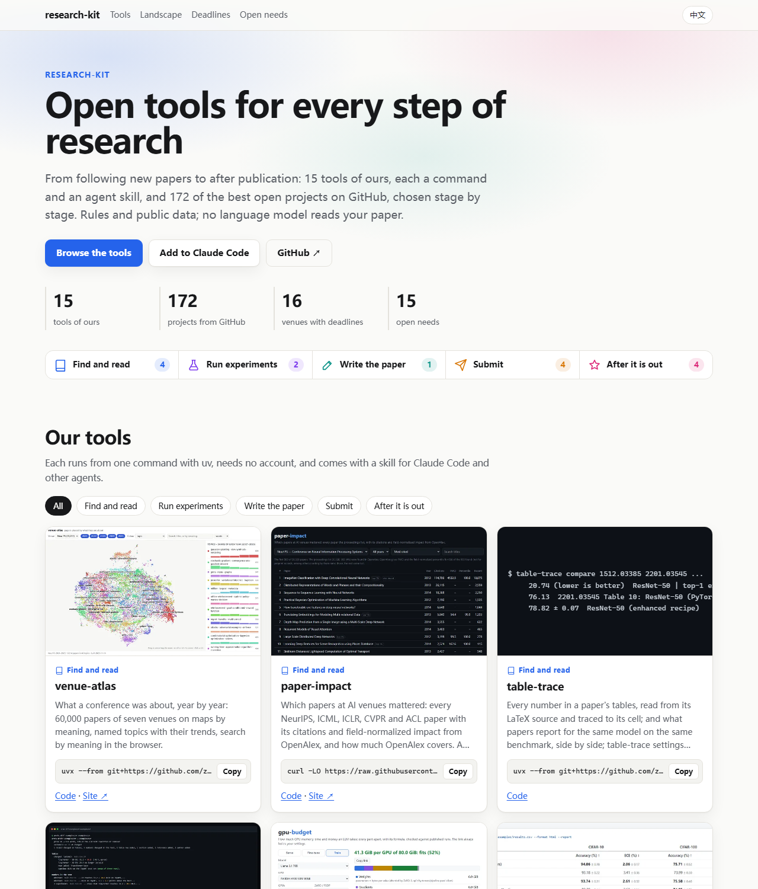

<div align="center">

# research-kit

**科研每个阶段可用的开源工具，从跟踪新论文到论文发表之后。** 我们自己的 15 个工具，每个都是一条命令和一个智能体技能；再加上按阶段挑选的 GitHub 上最好的其他项目，以及目前没有工具覆盖的需求。我们的工具靠规则和公开数据，不用大语言模型（venue-atlas 用一个小型嵌入模型给论文定位），给出的每个结果都标明出处。

<a href="LICENSE"></a>


[English](README.md) · **简体中文** · **[zch6a.github.io/research-kit](https://zch6a.github.io/research-kit/)**

</div>

---

<p align="center"><a href="https://zch6a.github.io/research-kit/"></a></p>

## 使用方法

**单独使用我们的工具**：每个工具下面的命令就是用法。需要先装 [uv](https://docs.astral.sh/uv/)（需要时它会自动准备 Python 3.10+）；gpu-budget 需要 Node 22+。命令里的 `@v0` 指该工具的最新发布版，这个标签会随每次发布移动（想固定版本就换成某个提交）。

**作为智能体技能**：在 Claude Code 里先添加一次插件市场，再按名字安装需要的工具（下面每个都可以）：

```text
/plugin marketplace add zch6a/research-kit
/plugin install table-trace@research-kit
/plugin install paper-proof@research-kit
```

每个插件就是一个工具的技能，取自该工具仓库的 `v0`：智能体运行工具，引用它找到的结果并注明出处。只有用技能时才需要 Claude Code，单独用工具不需要。

## 科研的每个阶段

每一部分先列我们的工具（标为“我们的”，附命令），再列值得了解的其他项目，按星数排序。

<!-- tools:start -->
其他项目的星数、许可证和更新月份取自 GitHub API（2026-11-14）。许可证为“无”表示仓库没有许可证文件，复用前请先询问作者。

### 找文献、读论文

#### 跟踪新论文

**[arxiv-diff](https://github.com/zch6a/arxiv-diff)** (我们的) — 论文两个版本之间改了什么：表格里按行列对应的结果数字，以及正文、摘要、作者、图和参考文献。arxiv-diff watch 告诉你 .bib 里哪些 arXiv 论文发了新版本。

```bash
uvx --from git+https://github.com/zch6a/arxiv-diff@v0 arxiv-diff 2106.09685
```

| 项目 | 用途 | 星数 | 许可证 | 更新 |
|---|---|--:|---|---|
| [zotero-arxiv-daily](https://github.com/TideDra/zotero-arxiv-daily) | 按你 Zotero 文献库里已有论文的相似度，每天给你推荐当天新出的 arXiv 论文并附上大模型写的摘要，发到邮箱。 | 6.2k | AGPL-3.0 | 2026-11 |
| [daily-arXiv-ai-enhanced](https://github.com/dw-dengwei/daily-arXiv-ai-enhanced) | 每天抓取指定 arXiv 分类的新论文，用大模型逐篇总结，生成一个可浏览的 GitHub Pages 网站。 | 3k | 其他 | 2026-09 |
| [arxiv-sanity-lite](https://github.com/karpathy/arxiv-sanity-lite) | 自建的 arXiv 浏览站点：给喜欢的论文打标签，它据此推荐相似的新论文。 | 1.7k | MIT | 2023-06 |
| [cv-arxiv-daily](https://github.com/Vincentqyw/cv-arxiv-daily) | 一个模板：按关键词每天自动更新一张 arXiv 新论文表（带代码链接），由 GitHub Actions 维护。 | 1.5k | Apache-2.0 | 2026-11 |
| [agents-radar](https://github.com/duanyytop/agents-radar) | 把 GitHub、arXiv、Hugging Face、Hacker News 等来源合成一份每日 AI 动态简报。 | 1.2k | MIT | 2026-11 |
| [daily-paper-reader](https://github.com/ziwenhahaha/daily-paper-reader) | 每天推荐 arXiv 和 OpenReview 新论文，并能用 AI 阅读和问答，通过 GitHub Actions 部署到 GitHub Pages。 | 979 | MIT | 2026-10 |
| [papers.cool](https://github.com/bojone/papers.cool) | Cool Papers 网站的代码：快速浏览 arXiv 新论文和会议论文集，每篇都可以让大模型（Kimi）讲解。 | 820 | 无 | 2026-07 |
| [Wispar](https://github.com/Scriptbash/Wispar) | 手机和桌面应用，订阅期刊目录更新和新文章，并查找开放获取版本。 | 226 | GPL-3.0 | 2026-11 |

#### 检索文献

**[venue-atlas](https://github.com/zch6a/venue-atlas)** (我们的) · [网站](https://zch6a.github.io/venue-atlas/) — 一个会议这些年都在研究什么：七个会议的 6 万篇论文按内容画成地图，主题有名字、有逐年趋势，可以在浏览器里按语义搜索。

```bash
uvx --from git+https://github.com/zch6a/venue-atlas@v0 venue-atlas model    # the model, 30 MB, once
uvx --from git+https://github.com/zch6a/venue-atlas@v0 venue-atlas build iclr icml --out site
```

**[paper-impact](https://github.com/zch6a/paper-impact)** (我们的) · [网站](https://zch6a.github.io/paper-impact/) — AI 会议里哪些论文真正有影响：NeurIPS、ICML、ICLR、CVPR、ACL 的每篇论文，附 OpenAlex 的引用数和按领域归一化的影响力，并注明 OpenAlex 覆盖了多少。有免费的 OpenAlex key 时，完整构建只要几天而不是几个月。

```bash
curl -LO https://raw.githubusercontent.com/zch6a/paper-impact/v0/venues.json
uvx --from git+https://github.com/zch6a/paper-impact@v0 paper-impact build venues.json -o site/ --years 2024
```

| 项目 | 用途 | 星数 | 许可证 | 更新 |
|---|---|--:|---|---|
| [arxiv-mcp-server](https://github.com/blazickjp/arxiv-mcp-server) | MCP 服务：让 AI 助手检索 arXiv、按章节读论文 LaTeX 原文、获取 BibTeX。 | 3.3k | Apache-2.0 | 2026-10 |
| [scholarly](https://github.com/scholarly-python-package/scholarly) | 用 Python 从 Google Scholar 获取作者主页和论文信息。 | 1.9k | Unlicense | 2026-03 |
| [OpenScholar](https://github.com/AkariAsai/OpenScholar) | 检索增强的大模型，从 4500 万篇开放论文中检索并带引用地回答科研问题。 | 1.7k | Apache-2.0 | 2025-08 |
| [pasa](https://github.com/bytedance/pasa) | 大模型智能体：针对一个具体的文献查询，自己检索、读论文、顺着引用找，返回相关论文列表。 | 1.7k | Apache-2.0 | 2025-05 |
| [arxiv.py](https://github.com/lukasschwab/arxiv.py) | arXiv API 的 Python 封装：检索、翻页、下载 PDF 或源码。 | 1.6k | MIT | 2026-11 |
| [asreview](https://github.com/asreview/asreview) | 系统综述的主动学习筛选工具：你标几篇标题摘要，它把剩下的按相关可能性排序。 | 1.1k | Apache-2.0 | 2026-11 |
| [semanticscholar](https://github.com/danielnsilva/semanticscholar) | Semantic Scholar API 的 Python 客户端：检索论文和作者、取引用与参考文献、获取推荐。 | 485 | MIT | 2026-08 |
| [pyalex](https://github.com/J535D165/pyalex) | OpenAlex 的 Python 客户端：查论文、作者、期刊会议和引用关系，支持过滤和翻页。 | 432 | MIT | 2026-10 |
| [ai2-scholarqa-lib](https://github.com/allenai/ai2-scholarqa-lib) | Ai2 Scholar QA 的代码库：在 Semantic Scholar 上多步检索，生成分节、带引用的文献综述式回答。 | 289 | Apache-2.0 | 2026-10 |
| [LocalCitationNetwork.github.io](https://github.com/LocalCitationNetwork/LocalCitationNetwork.github.io) | 浏览器里运行：从几篇种子论文出发，用 OpenAlex/Semantic Scholar/Crossref 构建引用网络，帮你找漏掉的相关工作。 | 150 | GPL-3.0 | 2026-05 |

#### 管理参考文献

| 项目 | 用途 | 星数 | 许可证 | 更新 |
|---|---|--:|---|---|
| [zotero](https://github.com/zotero/zotero) | 桌面文献管理软件：从浏览器抓取论文、保存 PDF、做批注，并在 Word/LibreOffice 里插入引用。 | 15.9k | 其他 | 2026-11 |
| [jasminum](https://github.com/l0o0/jasminum) | Zotero 插件：从知网抓取中文文献元数据，处理中文姓名和附件问题。 | 7.4k | AGPL-3.0 | 2026-11 |
| [zotero-better-bibtex](https://github.com/retorquere/zotero-better-bibtex) | Zotero 插件：生成稳定的引用键，并自动导出、同步 .bib 文件给 LaTeX 用。 | 7.3k | MIT | 2026-11 |
| [zotero-mcp](https://github.com/54yyyu/zotero-mcp) | MCP 服务：让 AI 助手检索、阅读和批注你的 Zotero 文献库，支持语义检索。 | 5.9k | MIT | 2026-11 |
| [jabref](https://github.com/JabRef/jabref) | 直接编辑 .bib/.biblatex 文件的桌面文献管理器，支持按 DOI/arXiv 抓取、查重和引用键规则。 | 4.9k | MIT | 2026-11 |
| [rebiber](https://github.com/yuchenlin/rebiber) | 把 .bib 中的 arXiv 条目替换为 DBLP 和 ACL Anthology 上的正式发表版本。 | 3k | MIT | 2026-11 |
| [papis](https://github.com/papis/papis) | 命令行的文献和文档管理器，把论文存成普通文件夹加 YAML 元数据。 | 1.8k | GPL-3.0 | 2026-11 |
| [bibtex-tidy](https://github.com/FlamingTempura/bibtex-tidy) | 整理和格式化 BibTeX 文件：排序、去重、统一字段；有命令行和网页版。 | 1.1k | MIT | 2026-10 |
| [zotero-format-metadata](https://github.com/northword/zotero-format-metadata) | Zotero 插件：检查并统一条目元数据，如标题大小写、期刊缩写、语言字段、重复项。 | 1.1k | AGPL-3.0 | 2026-11 |
| [betterbib](https://github.com/texworld/betterbib) | 命令行工具：用 Crossref/DBLP 更新 .bib 条目、按 DOI 获取 BibTeX、同步字段。 | 842 | 无 | 2026-11 |

#### 阅读与笔记

**[table-trace](https://github.com/zch6a/table-trace)** (我们的) — 论文表格里的每个数字都从 LaTeX 源码读出、标明在哪个单元格；还能把各篇论文对同一模型在同一基准上报告的结果并排列出来；table-trace settings 列出每篇论文在某个基准上的评测设置（shot 数、思维链、解码、评测框架）及不同之处。

```bash
uvx --from git+https://github.com/zch6a/table-trace@v0 table-trace compare 1512.03385 2201.03545 --row ResNet-50 --col top-1 --col acc
```

| 项目 | 用途 | 星数 | 许可证 | 更新 |
|---|---|--:|---|---|
| [MinerU](https://github.com/opendatalab/MinerU) | 把 PDF（含公式和表格）转成 Markdown/JSON，方便在别的工具里阅读或喂给大模型。 | 83.6k | 其他 | 2026-11 |
| [gpt_academic](https://github.com/binary-husky/gpt_academic) | 大模型工作台，内置论文相关功能：PDF/LaTeX 全文翻译、总结、润色、读 arXiv 论文。 | 71.7k | GPL-3.0 | 2026-01 |
| [open-notebook](https://github.com/lfnovo/open-notebook) | 自托管的 NotebookLM 替代品：导入论文等资料，与其对话、记笔记、生成播客式讲解。 | 41.9k | MIT | 2026-11 |
| [PDFMathTranslate](https://github.com/PDFMathTranslate/PDFMathTranslate) | 翻译科学论文 PDF，保留公式、图表和排版，输出译文版或双语对照版。 | 38.4k | AGPL-3.0 | 2026-11 |
| [zotero-pdf-translate](https://github.com/windingwind/zotero-pdf-translate) | Zotero 插件：阅读时划词翻译，也能翻译批注、标题和摘要，支持 20 多种翻译服务。 | 12.3k | AGPL-3.0 | 2026-11 |
| [sioyek](https://github.com/ahrm/sioyek) | 面向论文的键盘驱动 PDF 阅读器：悬停预览参考文献和图表、智能跳转、高亮可检索。 | 10k | GPL-3.0 | 2026-11 |
| [paper-qa](https://github.com/Future-House/paper-qa) | 对一批论文做问答：检索后给出带引用、经核对的答案（PaperQA2）。 | 9.6k | Apache-2.0 | 2026-11 |
| [zotero-better-notes](https://github.com/windingwind/zotero-better-notes) | Zotero 插件：双向链接笔记、笔记模板、大纲视图，并能把笔记同步成 Markdown。 | 8.5k | AGPL-3.0 | 2026-11 |
| [zotero-pdf2zh](https://github.com/guaguastandup/zotero-pdf2zh) | Zotero 插件：对论文调用 PDFMathTranslate，把生成的双语 PDF 挂回条目。 | 8.3k | AGPL-3.0 | 2026-11 |
| [zotero-gpt](https://github.com/MuiseDestiny/zotero-gpt) | Zotero 插件：用大模型与当前 PDF 或选中条目对话，做总结或打标签。 | 7.5k | AGPL-3.0 | 2026-10 |
| [grobid](https://github.com/grobidOrg/grobid) | 从学术 PDF 中抽取题录信息、章节结构和解析后的参考文献列表，输出 TEI XML。 | 5.2k | Apache-2.0 | 2026-11 |

#### AI 科研助手

| 项目 | 用途 | 星数 | 许可证 | 更新 |
|---|---|--:|---|---|
| [autoresearch](https://github.com/karpathy/autoresearch) | 让编程智能体在单卡上自动跑大量小规模训练实验，保留能提升指标的改动。 | 100k | 无 | 2026-03 |
| [deer-flow](https://github.com/bytedance/deer-flow) | 多智能体框架：检索、在沙箱里跑代码、撰写报告，可处理耗时较长的研究任务。 | 85.3k | MIT | 2026-11 |
| [storm](https://github.com/stanford-oval/storm) | 围绕一个主题检索资料，写出带引用的维基百科式综述，适合快速了解陌生领域。 | 31.9k | MIT | 2025-09 |
| [gpt-researcher](https://github.com/assafelovic/gpt-researcher) | 深度研究智能体：检索网页或本地文档，用任意大模型写出带引用的报告。 | 30.7k | Apache-2.0 | 2026-11 |
| [AI-Scientist-v2](https://github.com/SakanaAI/AI-Scientist-v2) | 端到端的“AI 科学家”：提出想法、用智能体树搜索跑实验，并写出研讨会水平的论文草稿。 | 7.5k | 其他 | 2025-12 |

### 做实验

#### 运行与记录实验

| 项目 | 用途 | 星数 | 许可证 | 更新 |
|---|---|--:|---|---|
| [ray](https://github.com/ray-project/ray) | 分布式计算框架，其中 Ray Tune 能在多卡多机上并行跑超参数搜索。 | 44.3k | Apache-2.0 | 2026-11 |
| [mlflow](https://github.com/mlflow/mlflow) | 把每次实验的参数、指标和产物记到本地或自建服务器上，在网页里对比不同运行。 | 28.8k | Apache-2.0 | 2026-11 |
| [optuna](https://github.com/optuna/optuna) | 超参数搜索库，能提前剪掉差的试验，接口灵活，并有看板查看搜索过程。 | 15k | MIT | 2026-11 |
| [hydra](https://github.com/hydra-ecosystem/hydra) | 用 YAML 文件和命令行覆盖组合实验配置，并能按配置批量扫参。 | 10.7k | MIT | 2026-11 |
| [cookiecutter-data-science](https://github.com/drivendataorg/cookiecutter-data-science) | 生成标准的数据科学/研究项目目录结构，让数据、代码和结果分开存放。 | 10.1k | MIT | 2026-11 |
| [clearml](https://github.com/clearml/clearml) | 自动记录实验，并带任务队列和执行代理，可以把一次运行复制到别的机器上重跑。 | 6.9k | Apache-2.0 | 2026-11 |
| [aim](https://github.com/aimhubio/aim) | 可自建的实验记录工具，界面能快速查询、对比成千上万次运行的指标曲线。 | 6.3k | Apache-2.0 | 2026-11 |
| [lightning-hydra-template](https://github.com/ashleve/lightning-hydra-template) | 把 PyTorch Lightning 和 Hydra 结合好的项目模板，带日志、测试和实验配置约定。 | 5.4k | 无 | 2026-06 |
| [SwanLab](https://github.com/SwanHubX/SwanLab) | 轻量的实验记录工具，接口与 W&B 相近，可离线或自建看板，国内实验室用得多。 | 4.4k | Apache-2.0 | 2026-11 |
| [trackio](https://github.com/gradio-app/trackio) | 可直接替换 wandb 记录接口，运行数据存在本地，看板可放到 Hugging Face Space 上。 | 1.8k | MIT | 2026-11 |

#### 算力与环境

**[gpu-budget](https://github.com/zch6a/gpu-budget)** (我们的) · [网站](https://zch6a.github.io/gpu-budget/) — 训练、微调或部署一个大模型要多少显存、时间和钱，每一项都给出公式（ZeRO/FSDP、各种并行、MoE、LoRA/QLoRA、KV 缓存），并和公开的训练记录对照过。

```bash
npx github:zch6a/gpu-budget#v0 train llama-3.1-70b --gpus 64 --zero 3 --tokens 2e12 --price 2.5
```

| 项目 | 用途 | 星数 | 许可证 | 更新 |
|---|---|--:|---|---|
| [uv](https://github.com/astral-sh/uv) | 速度很快的 Python 包和环境管理器，带锁文件，研究环境能快速重建。 | 92k | Apache-2.0 | 2026-11 |
| [nvtop](https://github.com/Syllo/nvtop) | 类似 htop 的 GPU 监控，支持 NVIDIA、AMD、Intel 和苹果 GPU。 | 11.2k | 其他 | 2026-11 |
| [skypilot](https://github.com/skypilot-org/skypilot) | 同一份任务 YAML 可在各家云、Kubernetes 或 Slurm 上运行，自动挑最便宜的可用 GPU，支持抢占式实例。 | 10.8k | Apache-2.0 | 2026-11 |
| [pixi](https://github.com/prefix-dev/pixi) | 基于 conda 生态的包管理器，按项目生成锁文件，能管 CUDA 等非 Python 依赖。 | 8k | BSD-3-Clause | 2026-11 |
| [nvitop](https://github.com/XuehaiPan/nvitop) | 交互式 GPU 进程查看器，显示每个进程的显存、利用率和所属用户，也可作为 Python 库调用。 | 7.3k | Apache-2.0 | 2026-11 |
| [slurm](https://github.com/SchedMD/slurm) | 大多数高校和国家超算集群使用的作业调度系统。 | 4.5k | 其他 | 2026-11 |
| [gpustat](https://github.com/wookayin/gpustat) | 每块 GPU 一行显示显存、利用率和使用者，适合脚本里用或查看共享服务器谁在占卡。 | 4.4k | MIT | 2026-10 |
| [dstack](https://github.com/dstackai/dstack) | 开源的 GPU 编排工具，在云上或自有机器上开开发环境、跑训练任务和部署服务。 | 2.3k | MPL-2.0 | 2026-11 |
| [apptainer](https://github.com/apptainer/apptainer) | 容器运行时（原 Singularity），无需 root 即可运行镜像，是超算集群上使用容器的常见方式。 | 2k | 其他 | 2026-11 |
| [submitit](https://github.com/facebookincubator/submitit) | 把 Python 函数直接提交成 Slurm 作业并像 future 一样取回结果，用普通 Python 就能在集群上扫参。 | 1.6k | MIT | 2026-11 |
| [task-spooler](https://github.com/justanhduc/task-spooler) | 单台机器上的任务队列：命令依次排队，每个任务分到空闲的 GPU（ts -G）。 | 448 | GPL-2.0 | 2024-03 |

#### 数据与评测

**[exp-tables](https://github.com/zch6a/exp-tables)** (我们的) — 把实验结果变成论文里的表：多个种子的均值 ± 标准差、与最好方法的显著性检验，只有多个种子的结果支持时才加粗；可读 CSV、wandb、TensorBoard、MLflow。

```bash
uvx --from git+https://github.com/zch6a/exp-tables@v0 exp-tables results.csv --format markdown
```

| 项目 | 用途 | 星数 | 许可证 | 更新 |
|---|---|--:|---|---|
| [label-studio](https://github.com/HumanSignal/label-studio) | 可自建的标注工具，支持文本、图像、音频、视频和大模型输出，标注界面可配置。 | 28.7k | Apache-2.0 | 2026-11 |
| [cvat](https://github.com/cvat-ai/cvat) | 图像和视频标注工具（框、多边形、轨迹），支持模型辅助标注。 | 17.1k | MIT | 2026-11 |
| [dvc](https://github.com/treeverse/dvc) | 配合 Git 给大数据集和模型做版本管理，并定义从数据到指标的可复现流水线。 | 16k | Apache-2.0 | 2026-11 |
| [lm-evaluation-harness](https://github.com/EleutherAI/lm-evaluation-harness) | 在数百个标准基准上用固定提示评测语言模型，使不同论文的分数可比。 | 14.5k | MIT | 2026-11 |
| [opencompass](https://github.com/open-compass/opencompass) | 覆盖大量中英文基准的大模型和多模态模型评测平台。 | 7.6k | Apache-2.0 | 2026-11 |
| [inspect_ai](https://github.com/UKGovernmentBEIS/inspect_ai) | 编写大模型和智能体评测的框架，带求解器、工具调用、沙箱和日志查看器。 | 3.2k | MIT | 2026-11 |
| [helm](https://github.com/stanford-crfm/helm) | 从多场景、多指标（不只准确率）全面评测语言模型，并有公开排行榜。 | 3k | Apache-2.0 | 2026-09 |
| [lighteval](https://github.com/huggingface/lighteval) | 支持多种推理后端的快速大模型评测，保存逐条样本结果便于检查。 | 2.6k | MIT | 2026-11 |
| [scikit-posthocs](https://github.com/maximtrp/scikit-posthocs) | 提供 Nemenyi、Conover、Dunn 等事后检验和临界差异图，用于在多个数据集上比较多种方法。 | 392 | MIT | 2026-11 |
| [deep-significance](https://github.com/Kaleidophon/deep-significance) | 比较多次随机种子下深度学习模型的显著性检验，含 ASO 检验和多重比较校正。 | 343 | GPL-3.0 | 2026-09 |

### 写论文

#### 写作与排版

| 项目 | 用途 | 星数 | 许可证 | 更新 |
|---|---|--:|---|---|
| [typst](https://github.com/typst/typst) | 新一代排版系统，标记简单、增量编译快，正逐渐成为论文和学位论文中 LaTeX 的替代选择。 | 57.2k | Apache-2.0 | 2026-11 |
| [pandoc](https://github.com/jgm/pandoc) | 通用文档转换器：Markdown、LaTeX、Word、HTML 等互转，并支持 citeproc 处理参考文献。 | 46.9k | GPL-2.0 | 2026-11 |
| [overleaf](https://github.com/overleaf/overleaf) | Overleaf 协作式 LaTeX 编辑器的源码，课题组可以自行部署（社区版）。 | 18.3k | AGPL-3.0 | 2026-09 |
| [LaTeX-Workshop](https://github.com/James-Yu/LaTeX-Workshop) | VS Code 的 LaTeX 插件：编译、PDF 预览与正反向跳转、自动补全和检查。 | 12.4k | MIT | 2026-11 |
| [quarto-cli](https://github.com/quarto-dev/quarto-cli) | 基于 Pandoc 的出版系统，把含可运行代码的 Markdown/Notebook 输出为 PDF、期刊格式和网页。 | 6.2k | 其他 | 2026-11 |
| [thuthesis](https://github.com/tuna/thuthesis) | 清华大学 LaTeX 学位论文模板，也是众多国内高校论文模板的代表。 | 5.5k | LPPL-1.3c | 2026-08 |
| [tectonic](https://github.com/tectonic-typesetting/tectonic) | 自包含的 TeX 引擎，按需下载宏包，无需完整安装 TeX Live 也能可复现地编译论文。 | 5.2k | 其他 | 2026-08 |
| [texstudio](https://github.com/texstudio-org/texstudio) | 桌面 LaTeX 编辑器，自带 PDF 阅读、补全和文档结构视图。 | 3.7k | GPL-3.0 | 2026-11 |
| [acl-style-files](https://github.com/acl-org/acl-style-files) | ACL 系列会议（ACL、EMNLP、NAACL 等）的官方 LaTeX 模板。 | 2.1k | 无 | 2026-06 |

#### 检查文字

| 项目 | 用途 | 星数 | 许可证 | 更新 |
|---|---|--:|---|---|
| [awesome-ai-research-writing](https://github.com/Leey21/awesome-ai-research-writing)（清单） | 整理用大模型润色、翻译和检查论文的提示词与流程。 | 35.9k | 无 | 2026-08 |
| [languagetool](https://github.com/languagetool-org/languagetool) | 开源语法、风格和拼写检查器，支持 25 种以上语言，可本地部署为服务。 | 15.3k | LGPL-2.1 | 2026-11 |
| [vale](https://github.com/vale-cli/vale) | 可识别标记语法的文本检查器，可自定义风格规则（如空泛词、被动语态）。 | 6.4k | MIT | 2026-11 |
| [Paper-Writing-Tips](https://github.com/MLNLP-World/Paper-Writing-Tips)（清单） | MLNLP 社区整理的论文写作与投稿常见小错误清单（中英文）。 | 4.7k | 无 | 2026-09 |
| [paperdebugger](https://github.com/PaperDebugger/paperdebugger) | Overleaf 插件，用大模型智能体在编辑器内审阅论文并给出修改建议。 | 1.6k | AGPL-3.0 | 2026-07 |
| [latexindent.pl](https://github.com/cmhughes/latexindent.pl) | 格式化 LaTeX 源码（缩进、换行、一句一行），便于对比差异和多人协作。 | 1.1k | GPL-3.0 | 2026-11 |
| [textidote](https://github.com/sylvainhalle/textidote) | 对 LaTeX 源文件做拼写、语法和风格检查，错误能对应回原始行号。 | 1.1k | GPL-3.0 | 2026-09 |
| [latexdiff](https://github.com/ftilmann/latexdiff) | 把两个 LaTeX 版本的差异标注出来并生成 PDF，常用于返修时提交修改对照稿。 | 680 | GPL-3.0 | 2026-10 |
| [ltex-ls-plus](https://github.com/ltex-plus/ltex-ls-plus) | 在编辑器中对 LaTeX 和 Markdown 运行 LanguageTool 的语言服务器，会跳过命令和公式。 | 263 | MPL-2.0 | 2026-11 |

#### 图表与示意图

**[fig-check](https://github.com/zch6a/fig-check)** (我们的) — 按论文印出来的样子检查每张图：印刷后的字号、色觉异常读者分不清的颜色、位图分辨率；覆盖 LaTeX 工程里的所有图。paper_style 按栏宽、用论文的字体做 matplotlib 图；diagram 把 PyTorch 模型画成可编辑的 TikZ 结构图。

```bash
uvx --from git+https://github.com/zch6a/fig-check@v0 fig-check paper/
```

| 项目 | 用途 | 星数 | 许可证 | 更新 |
|---|---|--:|---|---|
| [excalidraw](https://github.com/excalidraw/excalidraw) | 白板工具，快速画手绘风格示意图，常用于论文首图和概览图。 | 135k | MIT | 2026-11 |
| [drawio-desktop](https://github.com/jgraph/drawio-desktop) | draw.io 桌面版，画流程图和系统框图，可导出 PDF/SVG 矢量图。 | 64k | GPL-3.0 | 2026-11 |
| [PlotNeuralNet](https://github.com/HarisIqbal88/PlotNeuralNet) | 用 LaTeX/TikZ 代码绘制 CNN 等神经网络结构图。 | 25.1k | MIT | 2023-08 |
| [scientific-visualization-book](https://github.com/rougier/scientific-visualization-book) | 开源的科学可视化书籍，附代码，讲解如何用 Matplotlib 画清晰的科研图。 | 11.7k | 其他 | 2026-01 |
| [SciencePlots](https://github.com/garrettj403/SciencePlots) | 适用于期刊和会议论文的 Matplotlib 样式（IEEE、Nature、高对比度与色盲友好配色）。 | 9.4k | MIT | 2026-06 |
| [PaperBanana](https://github.com/dwzhu-pku/PaperBanana) | 根据论文文本自动生成方法示意图和统计图的智能体流程。 | 7.6k | Apache-2.0 | 2026-11 |
| [NN-SVG](https://github.com/alexlenail/NN-SVG) | 网页工具，绘制全连接、LeNet 和 AlexNet 风格的网络结构示意图并导出 SVG。 | 5.7k | MIT | 2026-06 |
| [pgf](https://github.com/pgf-tikz/pgf) | PGF/TikZ 的源码，论文中大多数手绘示意图所用的 LaTeX 绘图语言（pgfplots 在同一组织下）。 | 1.4k | 无 | 2026-11 |
| [torchview](https://github.com/mert-kurttutan/torchview) | 用 Graphviz 画出 PyTorch 模型的真实计算图（层和张量形状）。 | 1.1k | MIT | 2026-02 |
| [CMasher](https://github.com/1313e/CMasher) | 感知均匀、对色盲友好的 Matplotlib 色图。 | 500 | BSD-3-Clause | 2026-10 |

### 投稿

#### 投稿前检查

**[paper-proof](https://github.com/zch6a/paper-proof)** (我们的) — 赶在审稿人之前检查论文：编造或写错的参考文献、标粗却不是最好的结果、对不上的提升幅度、摘要里过时的数字、失效的交叉引用（\label/\ref），以及整篇论文前后不一致的地方（同一缩写两种展开、同一个词两种写法），以及透过 LaTeX 看到的文字细节（同一个词写两遍、a/an、Figure~\ref）。加 --fix 另写一份改好的 .bib（预印本换成正式发表版，补上 Crossref 能确认的年份和 DOI）；加 --review 可供审稿人检查投稿的 PDF，不发送任何内容。

```bash
uvx --from git+https://github.com/zch6a/paper-proof@v0 paper-proof path/to/paper
```

**[submit-check](https://github.com/zch6a/submit-check)** (我们的) — 别因为疏忽被直接拒稿：按会议规定检查 LaTeX 论文（双盲信息泄露、模板模式、页数、必需章节、PDF 字体、残留的 TODO），检查补充材料压缩包里的名字、路径、.git 和文件元数据，以及终稿里评审版留下的东西。

```bash
uvx --from git+https://github.com/zch6a/submit-check@v0 submit-check path/to/paper
```

| 项目 | 用途 | 星数 | 许可证 | 更新 |
|---|---|--:|---|---|
| [arxiv-latex-cleaner](https://github.com/google-research/arxiv-latex-cleaner) | 清理 LaTeX 工程里的注释、未用文件和过大的图片，上传 arXiv 时不会把草稿内容一起公开。 | 7.1k | Apache-2.0 | 2026-11 |
| [aclpubcheck](https://github.com/acl-org/aclpubcheck) | 检查 ACL 格式论文 PDF 的越界、页数、字体、纸张大小，并提示参考文献问题。 | 1.1k | MIT | 2026-11 |
| [refchecker](https://github.com/markrussinovich/refchecker) | 把论文的每条参考文献与 Semantic Scholar、OpenAlex、arXiv 比对，指出作者、年份、会议错误或根本不存在的文献。 | 569 | MIT | 2026-10 |
| [arxiv-collector](https://github.com/djsutherland/arxiv-collector) | 按 latexmk 的依赖记录收集论文真正用到的文件（含 .bbl），打包成可直接上传 arXiv 的压缩包。 | 385 | BSD-3-Clause | 2025-07 |
| [citegate](https://github.com/chrisyangsong/citegate) | 把 BibTeX 与 Crossref、OpenAlex 的核对放进 CI，出现虚构或不匹配的条目就让构建失败。 | 101 | MIT | 2026-08 |
| [Paper-Linter](https://github.com/misc0110/Paper-Linter) | 扫描论文 LaTeX 源码里的常见错误，如引用前的空格、大小写不一致、缩写误用。 | 35 | MIT | 2026-08 |

#### 截稿日期与投稿

| 项目 | 用途 | 星数 | 许可证 | 更新 |
|---|---|--:|---|---|
| [ccf-deadlines](https://github.com/ccfddl/ccf-deadlines) | 社区维护的 CCF 推荐及其他计算机会议截稿时间，有网站、命令行和微信小程序。 | 9.5k | MIT | 2026-11 |
| [ai-deadlines](https://github.com/paperswithcode/ai-deadlines) | 最早的 AI 截稿倒计时网站，许多分支和各领域的追踪站都由它而来。 | 6k | MIT | 2024-09 |
| [anonymous_github](https://github.com/tdurieux/anonymous_github) | 为双盲评审提供匿名的只读 GitHub 仓库副本，隐藏文件和历史里的姓名。 | 2.3k | GPL-3.0 | 2026-11 |
| [sec-deadlines.github.io](https://github.com/sec-deadlines/sec-deadlines.github.io) | 安全与隐私方向会议的截稿倒计时。 | 875 | 无 | 2026-11 |
| [hotcrp](https://github.com/kohler/hotcrp) | 可自建的会议评审系统，涵盖投稿、分配审稿人、审稿和作者回复。 | 442 | 其他 | 2026-11 |
| [ai-deadlines](https://github.com/huggingface/ai-deadlines) | AI 会议截稿倒计时，是 Papers with Code 版本的持续维护版。 | 351 | MIT | 2026-09 |
| [openreview-py](https://github.com/openreview/openreview-py) | OpenReview 官方 Python 客户端，可获取投稿、审稿意见和决定，也能脚本化会议流程。 | 273 | MIT | 2026-11 |

#### 审稿与 rebuttal

**[iclr-scores](https://github.com/zch6a/iclr-scores)** (我们的) · [网站](https://zch6a.github.io/iclr-scores/) — ICLR 2017–2025 年的审稿分数最后换来了什么：各平均分的录用率、录用率过半的分数线、审稿人意见分歧的影响，以及你这组分数在往年的录用率。

```bash
uvx --from git+https://github.com/zch6a/iclr-scores@v0 iclr-scores odds 6 6 8 5 --year 2025
```

**[rebuttal-board](https://github.com/zch6a/rebuttal-board)** (我们的) — 逐条跟踪 rebuttal：把从 OpenReview 或 CMT 粘贴的审稿意见拆成意见点，生成 Markdown 跟踪表（每点的状态、需要的实验、回复），检查每份回复的长度是否超限，记录分数变化。离线运行。

```bash
uvx --from git+https://github.com/zch6a/rebuttal-board@v0 rebuttal init reviews.txt
```

| 项目 | 用途 | 星数 | 许可证 | 更新 |
|---|---|--:|---|---|
| [paperlists](https://github.com/papercopilot/paperlists) | 按会议整理好的投稿列表，含审稿分数和录用结果，来源于 OpenReview 等。 | 967 | 无 | 2026-11 |
| [AgentReview](https://github.com/Ahren09/AgentReview) | 用大模型智能体模拟审稿人、作者和领域主席，研究评审过程中的偏差。 | 718 | Apache-2.0 | 2026-05 |
| [Paper2Rebuttal](https://github.com/AutoLab-SAI-SJTU/Paper2Rebuttal) | 读入论文和审稿意见，逐条规划回应并起草 rebuttal 的多智能体系统。 | 565 | 无 | 2026-08 |
| [Rebuttal-Skill](https://github.com/TobiasLee/Rebuttal-Skill) | 引导编程智能体按结构撰写 rebuttal 的技能包。 | 507 | 无 | 2026-11 |
| [Paper-Rebuttal-Tips](https://github.com/MLNLP-World/Paper-Rebuttal-Tips)（清单） | 清单：MLNLP 社区整理的 rebuttal 写作建议和示例。 | 436 | 无 | 2026-10 |
| [PeerRead](https://github.com/allenai/PeerRead) | 带审稿意见和录用标签的论文数据集，附研究审稿用的基线代码。 | 432 | 无 | 2025-12 |
| [Researcher](https://github.com/zhu-minjun/Researcher) | 包含 DeepReviewer：一个能为机器学习论文写结构化审稿意见和打分的开源模型。 | 409 | 其他 | 2026-03 |
| [cv_rebuttal_template](https://github.com/guanyingc/cv_rebuttal_template) | CVPR/ICCV 风格一页 rebuttal 的 LaTeX 模板，排版紧凑。 | 308 | 无 | 2024-05 |
| [RebuttalStudio](https://github.com/runtsang/RebuttalStudio) | 写 rebuttal 的编辑器：整理审稿人问题、起草回答并控制篇幅。 | 225 | 无 | 2026-04 |
| [openreview-expertise](https://github.com/openreview/openreview-expertise) | 根据审稿人以往论文计算审稿人与投稿的匹配分数，供 OpenReview 分配使用。 | 51 | MIT | 2026-11 |

### 发表之后

#### 发布代码与数据

**[repro-score](https://github.com/zch6a/repro-score)** (我们的) — 别人能不能用你的代码复现论文：给科研代码仓库打一个百分制的分，每一项都附上依据所在的文件和行号，只读文件、不运行任何代码；repro-score release 检查版本号、标签、CITATION.cff 和 DOI 是否一致。

```bash
uvx --from git+https://github.com/zch6a/repro-score@v0 repro-score github:owner/repo
```

| 项目 | 用途 | 星数 | 许可证 | 更新 |
|---|---|--:|---|---|
| [huggingface_hub](https://github.com/huggingface/huggingface_hub) | 用 Python 或命令行把模型权重、数据集及其说明卡片上传到 Hugging Face Hub。 | 4k | Apache-2.0 | 2026-11 |
| [releasing-research-code](https://github.com/paperswithcode/releasing-research-code)（清单） | 发布机器学习代码的指南和 README 模板，NeurIPS 代码提交清单的来源。 | 3k | MIT | 2023-05 |
| [binderhub](https://github.com/jupyterhub/binderhub) | mybinder.org 的底层，读者点一个链接就能在浏览器里运行论文的 notebook。 | 2.7k | BSD-3-Clause | 2026-11 |
| [repo2docker](https://github.com/jupyterhub/repo2docker) | 根据仓库里的依赖或环境文件直接构建可运行的容器，不必写 Dockerfile。 | 1.7k | BSD-3-Clause | 2026-11 |
| [croissant](https://github.com/mlcommons/croissant) | 描述机器学习数据集的元数据格式和工具，NeurIPS 数据集与基准赛道要求使用。 | 921 | Apache-2.0 | 2026-11 |
| [osf.io](https://github.com/CenterForOpenScience/osf.io) | 开放科学框架 OSF 的源码，用于预注册、项目文件、预印本和 DOI。 | 730 | Apache-2.0 | 2026-11 |
| [datalad](https://github.com/datalad/datalad) | 基于 git-annex 管理和发布数据集，并记录每个输出由哪条命令生成，方便重跑。 | 677 | 其他 | 2026-11 |
| [citation-file-format](https://github.com/citation-file-format/citation-file-format) | CITATION.cff 规范，让 GitHub、Zenodo 和 Zotero 为仓库显示正确的引用格式。 | 562 | CC-BY-4.0 | 2026-09 |
| [reprozip](https://github.com/VIDA-NYU/reprozip) | 追踪一次命令运行，把用到的所有文件和库打包，别人可以原样重放。 | 364 | BSD-3-Clause | 2026-02 |
| [zenodo-rdm](https://github.com/zenodo/zenodo-rdm) | Zenodo 的源码；Zenodo 为代码、数据等存档并分配 DOI，可在每次 GitHub 发布时自动生成。 | 351 | GPL-3.0 | 2026-11 |

#### 项目主页与个人主页

**[paper-page](https://github.com/zch6a/paper-page)** (我们的) · [网站](https://zch6a.github.io/paper-page/) — 用 arXiv 编号生成论文项目主页：链接、预览图、摘要、BibTeX、Google Scholar 标签与社交分享预览标签（Open Graph），一个静态 HTML 文件，直接放到 GitHub Pages。

```bash
uvx --from git+https://github.com/zch6a/paper-page@v0 paper-page new 2003.08934 -o page/
```

| 项目 | 用途 | 星数 | 许可证 | 更新 |
|---|---|--:|---|---|
| [academicpages.github.io](https://github.com/academicpages/academicpages.github.io) | 个人学术主页的 GitHub Pages 模板，含论文、报告、教学和简历页。 | 17.8k | MIT | 2026-11 |
| [al-folio](https://github.com/alshedivat/al-folio) | 面向学者的 Jekyll 主题，用 BibTeX 生成论文列表，带项目页、博客和简历。 | 16.3k | MIT | 2026-11 |
| [Academic-project-page-template](https://github.com/eliahuhorwitz/Academic-project-page-template) | 填空式的论文项目主页 HTML 模板，含预告视频、摘要、图、海报和 BibTeX。 | 5.3k | 无 | 2025-09 |
| [hugo-theme-academic-cv](https://github.com/HugoBlox/hugo-theme-academic-cv) | Hugo 学术主页模板（原 Wowchemy / Hugo Academic），可导入 BibTeX。 | 5.1k | MIT | 2026-11 |
| [nerfies.github.io](https://github.com/nerfies/nerfies.github.io) | Nerfies 的项目主页，大多数机器学习论文主页都由它改来。 | 4.4k | 无 | 2024-06 |
| [jonbarron.github.io](https://github.com/jonbarron/jonbarron.github.io) | Jon Barron 的纯 HTML 主页，被大量复用的单页研究者主页样式出自这里。 | 3.7k | 无 | 2026-11 |
| [acad-homepage.github.io](https://github.com/RayeRen/acad-homepage.github.io) | 单页学术主页模板，可自动显示 Google Scholar 引用数。 | 3k | MIT | 2026-09 |
| [jekyll-scholar](https://github.com/inukshuk/jekyll-scholar) | 从 BibTeX 生成论文列表和引用的 Jekyll 插件。 | 1.2k | MIT | 2026-01 |
| [minimal-light](https://github.com/yaoyao-liu/minimal-light) | 带论文列表的极简 Jekyll 学术主页主题。 | 1.1k | CC0-1.0 | 2026-10 |
| [academic-homepage](https://github.com/luost26/academic-homepage) | 学术主页 GitHub Pages 模板，论文信息存放在 YAML 中。 | 731 | MIT | 2026-10 |
| [academic-project-astro-template](https://github.com/RomanHauksson/academic-project-astro-template) | 用 Astro 重做的 Nerfies 式主页，内容用 Markdown/MDX 写，有图片和视频组件。 | 558 | 无 | 2026-06 |
| [paper2anything](https://github.com/QuZhan51496/paper2anything) | 把论文 PDF 转成网页、幻灯片、海报和社交平台帖子的智能体技能包。 | 485 | Apache-2.0 | 2026-07 |
| [academic-project-page-template-vue](https://github.com/JunyaoHu/academic-project-page-template-vue) | 基于 Vue、由配置文件驱动的项目主页模板。 | 336 | 无 | 2025-07 |

#### 海报、幻灯片与报告

| 项目 | 用途 | 星数 | 许可证 | 更新 |
|---|---|--:|---|---|
| [reveal.js](https://github.com/hakimel/reveal.js) | HTML 演示框架，许多 Markdown 和 Quarto 幻灯片工具都基于它。 | 72.6k | MIT | 2026-09 |
| [slidev](https://github.com/slidevjs/slidev) | 用 Markdown 写幻灯片，支持实时代码、LaTeX 公式和 Vue 组件，可导出 PDF。 | 49.5k | MIT | 2026-11 |
| [marp](https://github.com/marp-team/marp) | 用纯 Markdown 写幻灯片，导出 PDF、HTML 或 PowerPoint。 | 12.7k | MIT | 2026-11 |
| [mtheme](https://github.com/matze/mtheme) | Metropolis：简洁现代的 Beamer 主题。 | 6.9k | 无 | 2022-11 |
| [Paper2Poster](https://github.com/Paper2Poster/Paper2Poster) | 从论文 PDF 自动生成可编辑海报的多智能体系统。 | 4.1k | MIT | 2026-11 |
| [Paper2Slides](https://github.com/HKUDS/Paper2Slides) | 一步把论文生成幻灯片。 | 3.9k | MIT | 2026-05 |
| [touying](https://github.com/touying-typ/touying) | Typst 的幻灯片框架，有主题和动画，编译比 Beamer 快得多。 | 2.4k | MIT | 2026-11 |
| [Paper2Video](https://github.com/showlab/Paper2Video) | 从论文生成带幻灯片、字幕和讲者形象的报告视频。 | 2.4k | MIT | 2026-03 |
| [ultimate-beamer-theme-list](https://github.com/martinbjeldbak/ultimate-beamer-theme-list)（清单） | 清单：社区 Beamer 主题的截图和链接，含许多高校主题。 | 1.8k | 无 | 2026-11 |
| [beamer](https://github.com/josephwright/beamer) | Beamer 幻灯片 LaTeX 文档类，公式多的报告的默认选择。 | 1.7k | 其他 | 2026-08 |
| [gemini](https://github.com/anishathalye/gemini) | 简洁的 LaTeX beamerposter 会议海报主题。 | 1.3k | MIT | 2026-11 |
| [posterdown](https://github.com/brentthorne/posterdown) | 用 R Markdown 写会议海报，经 HTML 渲染为 PDF。 | 882 | 其他 | 2021-12 |
| [posterly](https://github.com/Chenruishuo/posterly) | 把海报写成一个 HTML/CSS 文件，再用无头浏览器输出尺寸正确的 PDF。 | 440 | AGPL-3.0 | 2026-11 |
| [latex-beamerposter](https://github.com/deselaers/latex-beamerposter) | 让 Beamer 主题可用于大幅海报的 beamerposter 宏包。 | 436 | GPL-2.0 | 2021-12 |
| [betterposter-latex-template](https://github.com/rafaelbailo/betterposter-latex-template) | Mike Morrison #betterposter 版式的 LaTeX 模板，中间放一句核心结论。 | 326 | GPL-3.0 | 2019-09 |
| [peace-of-posters](https://github.com/jonaspleyer/peace-of-posters) | 用 Typst 做科研海报的宏包，带主题和版块布局。 | 123 | MIT | 2026-09 |

#### 传播与引用跟踪

**[scholar-cards](https://github.com/zch6a/scholar-cards)** (我们的) — 把 OpenAlex 上你的引用数、h 指数和高被引论文做成 SVG 卡片，放进学术主页或 GitHub 个人页，由 GitHub Action 自动更新，不需要 API key；scholar-cards cited 列出谁引用了一篇论文、怎么说的，新引用排在前面。

```bash
uvx --from git+https://github.com/zch6a/scholar-cards@v0 scholar-cards search "Your Name"
```

| 项目 | 用途 | 星数 | 许可证 | 更新 |
|---|---|--:|---|---|
| [AutoPR](https://github.com/LightChen233/AutoPR) | 把论文转成适合各社交平台的推广帖并评估效果的研究代码。 | 103 | MIT | 2025-10 |
| [Scholar-Citation-Monitor](https://github.com/DreamH1gh/Scholar-Citation-Monitor) | 监视 Google Scholar 引用数变化的浏览器扩展。 | 78 | 无 | 2026-07 |

#### 课题组网站、读书会与教学

**[reading-group](https://github.com/zch6a/reading-group)** (我们的) · [网站](https://zch6a.github.io/reading-group/) — 用一个 GitHub 仓库办读书会：用 issue 推荐论文、点赞投票，日程和笔记放在仓库里，GitHub Action 生成网页和日历。

```bash
uvx --from git+https://github.com/zch6a/reading-group@v0 reading-group next --repo OWNER/NAME
```

| 项目 | 用途 | 星数 | 许可证 | 更新 |
|---|---|--:|---|---|
| [jupyter-book](https://github.com/jupyter-book/jupyter-book) | 用 Markdown 和 Notebook 构建课程讲义和书，代码可执行。 | 4.3k | BSD-3-Clause | 2026-11 |
| [h](https://github.com/hypothesis/h) | Hypothesis 网页批注的服务端，读书会可以在私有小组里一起批注论文。 | 3.2k | BSD-2-Clause | 2026-11 |
| [nbgrader](https://github.com/jupyter/nbgrader) | 创建、分发并批改 Notebook 作业。 | 1.4k | BSD-3-Clause | 2026-11 |
| [lab-website-template](https://github.com/greenelab/lab-website-template) | Jekyll 课题组网站模板，可根据 DOI、ORCID 等标识自动生成论文列表。 | 582 | BSD-3-Clause | 2026-11 |
| [theme-research-group](https://github.com/HugoBlox/theme-research-group) | 研究组网站的 Hugo 模板，含成员、论文、新闻和活动。 | 403 | MIT | 2024-10 |
<!-- tools:end -->

## 截稿日期与会议规则

<!-- deadlines:start -->
| 会议 | 下一个截稿日 | 时区 | 会议时间地点 | 页数（终稿）；必需 | 大模型、补充材料、回复 | 规则 |
|---|---|---|---|---|---|---|
| [CVPR 2027](https://cvpr.thecvf.com/Conferences/2027) | 摘要 2026-11-10，全文 2026-11-16 23:59 | UTC-12 | June 22-25, 2027, Seattle, WA, United States | 8 页 | 大模型: any tools; the authors are responsible for the content; 回复: a one-page PDF | [`--venue cvpr2026`](https://cvpr.thecvf.com/Conferences/2026/AuthorGuidelines) |
| [NAACL 2027](https://2027.naacl.org/) | 2026-12-23 23:59 (NAACL commitment after ARR meta-reviews; reviewed papers only) | UTC-12 | June 1-5, 2027, San Francisco, California, USA | 8 页; 必需：a section titled Limitations | 大模型: use for writing or coding disclosed in the Responsible NLP Checklist; 补充材料: software and data as two .tgz or .zip archives, anonymized | [`--venue acl-arr`](https://aclrollingreview.org/cfp) |
| [ACL 2027](https://2027.aclweb.org/) | 2027-01-04 23:59 (ARR Submission) | UTC-12 | August 20-22, 2027, Kyoto, Japan | 8 页; 必需：a section titled Limitations | 大模型: use for writing or coding disclosed in the Responsible NLP Checklist; 补充材料: software and data as two .tgz or .zip archives, anonymized | [`--venue acl-arr`](https://aclrollingreview.org/cfp) |
| [IJCAI 2027](https://2027.ijcai.org/) | 摘要 2027-01-04，全文 2027-01-11 23:59 (Separate satellite event: August 15-17, 2027, Hengqin, China) | AoE | August 7-13, 2027, Kyoto, Japan | 7 页 | 大模型: allowed; the authors take full responsibility for all content; 补充材料: with the paper, up to 50 MB, PDF or ZIP; 回复: April 7-10, 2026 | [`--venue ijcai2026`](https://2026.ijcai.org/ijcai-ecai-2026-call-for-papers-main-track/) |
| [COLT 2027](https://learningtheory.org/colt2027/) | 2027-01-29 23:59 (Expected rebuttal March 29 - April 2; author notification on or before May 3.) | AoE | June 28 - July 2, 2027, Tokyo, Japan | — | — | — |
| [AISTATS 2027](https://virtual.aistats.org/Conferences/2027) | 上一届：摘要 2026-09-29，全文 2026-10-06 23:59 | UTC-12 | May 3-6, 2027, Montréal, Canada | — | — | — |
| [ICLR 2027](https://iclr.cc/Conferences/2027) | 上一届：摘要 2026-09-18，全文 2026-09-25 23:59 | AoE | April 26-28, 2027, San Francisco, CA, USA | 9 (10) 页; 必需：a Reproducibility Statement (strongly encouraged) | 大模型: allowed; significant use described in a separate section on LLM usage; 补充材料: with the paper; 回复: comments on OpenReview, revisions until the end of the discussion period | [`--venue iclr2026`](https://iclr.cc/Conferences/2026/AuthorGuide) |
| [EMNLP 2026](https://2026.emnlp.org/) | 上一届：2026-08-02 23:59 (Commitment deadline for papers with ARR reviews and meta-reviews) | UTC-12 | October 25-27, 2026, Budapest, Hungary (Hybrid) | 8 页; 必需：a section titled Limitations | 大模型: use for writing or coding disclosed in the Responsible NLP Checklist; 补充材料: software and data as two .tgz or .zip archives, anonymized | [`--venue acl-arr`](https://aclrollingreview.org/cfp) |
| [AAAI 2027](https://aaai.org/conference/aaai/aaai-27/) | 上一届：摘要 2026-07-21，全文 2026-07-28 23:59 | UTC-12 | February 16-23, 2027, Montréal, Québec, Canada | 7 页; 必需：the reproducibility checklist | 补充材料: August 4, 2025, 11:59 PM UTC-12 (three days after the paper); 回复: author feedback window October 7-13, 2025 | [`--venue aaai2026`](https://aaai.org/conference/aaai/aaai-26/submission-instructions/) |
| [KDD 2027](https://kdd2027.kdd.org/) | 上一届：摘要 2026-07-19，全文 2026-07-26 23:59 (1st round of 2 total rounds) | AoE | August 1-5, 2027, San Jose, California, USA | 8 (9) 页 | 大模型: any use of generative AI disclosed in the submission form (ACM policy); 回复: Apr 4-17, 2026 (February cycle); October 4-18, 2025 (July cycle) | [`--venue kdd2026`](https://kdd2026.kdd.org/research-track-call-for-papers/) |
| [CoRL 2026](https://www.corl.org/) | 上一届：摘要 2026-05-25，全文 2026-05-28 23:59 | AoE | November 9-11, 2026, Austin, Texas, USA | — | — | — |
| [NeurIPS 2026](https://neurips.cc/Conferences/2026) | 上一届：摘要 2026-05-05，全文 2026-05-07 11:59 | UTC+0 | December 8-10 (Sydney), December 9-11 (Atlanta and Paris), 2026, Sydney, Australia; Atlanta, USA; Paris, France | 9 (10) 页; 必需：the NeurIPS paper checklist | 大模型: follow the NeurIPS LLM policy (https://neurips.cc/Conferences/2025/LLM); 补充材料: May 22, 2025 AoE (a week after the paper), up to 100 MB, one ZIP; 回复: one week to respond to the initial reviews | [`--venue neurips2025`](https://neurips.cc/Conferences/2025/CallForPapers) |
| [COLM 2026](https://colm.cc/Conferences/2026/CallForPapers) | 上一届：摘要 2026-03-26，全文 2026-03-31 23:59 | AoE | October 6-8, 2026, Hilton Union Square, San Francisco, USA | — | — | — |
| [ECCV 2026](https://eccv.ecva.net/) | 上一届：摘要 2026-02-26，全文 2026-03-05 14:00 | UTC-8 | September 10-12, 2026, Malmö, Sweden | 14 页 | 大模型: any tools; citing non-existent material leads to rejection; 补充材料: Mar 12, 2026, 11:00 PM CET (a week after the paper); 回复: a one-page PDF including references | [`--venue eccv2026`](https://eccv.ecva.net/Conferences/2026/SubmissionPolicies) |
| [ICML 2026](https://icml.cc/Conferences/2026) | 上一届：摘要 2026-01-24，全文 2026-01-29 11:59 (Paper Submissions Open on OpenReview Jan 08 2026 12:00AM UTC-0) | UTC+0 | July 6-11, 2026, Seoul, Korea | 8 (9) 页; 必需：an Impact Statement section | 大模型: allowed, to assist in writing or research; 补充材料: no separate deadline: with the paper | [`--venue icml2025`](https://icml.cc/Conferences/2025/CallForPapers) |
| [ICCV 2025](https://iccv.thecvf.com/Conferences/2025) | 上一届：摘要 2025-03-04，全文 2025-03-08 09:59 | UTC+0 | October 21-23, 2025, Honolulu, Hawaii (Hybrid) | — | — | — |

截稿日期截至 2026-11-14，取自 [ccf-deadlines](https://github.com/ccfddl/ccf-deadlines)（MIT，提交 `dae323c`），请以会议官网为准。页数、必需章节、大模型政策、补充材料和作者回复来自 submit-check 的规则，每条都注明官方出处（`--venue` 按它检查论文；规则对应 id 里的年份）。[网站](https://zch6a.github.io/research-kit/#zh-deadlines)上会显示剩余天数。
<!-- deadlines:end -->

## 还没有工具覆盖的需求

逐个阶段调研时发现的需求，列出最接近的项目和它们的不足。其中一些是我们自己工具的下一步，其余尚无人做。

<!-- gaps:start -->
- **按论文可能的影响给每日推荐排序：是否被会议接收、有没有开源代码、早期引用。**（跟踪新论文）不足之处：推荐工具只按与你研究方向的接近程度打分。paper-impact today 按是否已接收、是否有代码和早期引用给某个分类的最新 arXiv 论文排序，但还没有和你自己的研究方向结合。最接近的：[zotero-arxiv-daily](https://github.com/TideDra/zotero-arxiv-daily), [daily-arXiv-ai-enhanced](https://github.com/dw-dengwei/daily-arXiv-ai-enhanced)。部分已由我们的工具覆盖：[paper-impact](https://github.com/zch6a/paper-impact)。
- **看到一篇论文为什么被引用（使用、对比还是反驳），以及后来哪些结果超过了它。**（检索文献）不足之处：开源工具只显示谁引用了谁，不显示怎么引用。scholar-cards cited 给出 Semantic Scholar 收录的引用句（Mamba 约四分之三的引用有），并按规则加标签，与人工阅读约三分之二一致；可靠的引用意图以及哪些后续结果超过了它，仍只在付费服务里。最接近的：[LocalCitationNetwork.github.io](https://github.com/LocalCitationNetwork/LocalCitationNetwork.github.io), [semanticscholar](https://github.com/danielnsilva/semanticscholar)。部分已由我们的工具覆盖：[scholar-cards](https://github.com/zch6a/scholar-cards)。
- **从 LaTeX 源码翻译论文，公式、引用和图都保持原样。**（阅读与笔记）不足之处：现有翻译工具基于 PDF 版面，遇到密集的公式和表格仍会出错。最接近的：[PDFMathTranslate](https://github.com/PDFMathTranslate/PDFMathTranslate), [gpt_academic](https://github.com/binary-husky/gpt_academic)。
- **检查 AI 写的综述里，每条引用是否真的支持它所在的那句话。**（AI 科研助手）不足之处：科研智能体在生成时附上引用，但不会回头核对已有文稿。最接近的：[paper-qa](https://github.com/Future-House/paper-qa), [storm](https://github.com/stanford-oval/storm)。
- **检查一个研究想法是否新颖，并列出与之重叠的已有论文。**（AI 科研助手）不足之处：现有的新颖性检查只是几次检索加大模型判断。最接近的：[AI-Scientist-v2](https://github.com/SakanaAI/AI-Scientist-v2), [ai2-scholarqa-lib](https://github.com/allenai/ai2-scholarqa-lib)。
- **判断论文里的基准分数能否与你的直接比较：评测框架、提示词、样例数、解码设置是否一致。**（数据与评测）不足之处：同一个任务用不同评测框架会得到不同分数，论文也很少写明设置。table-trace settings 读取每篇论文写明的设置（shot 数、思维链、解码、评测框架、指标）并列出不同之处；论文没写的它无从得知，提示词本身也不比较。最接近的：[lm-evaluation-harness](https://github.com/EleutherAI/lm-evaluation-harness), [opencompass](https://github.com/open-compass/opencompass)。部分已由我们的工具覆盖：[table-trace](https://github.com/zch6a/table-trace)。
- **小课题组几台 GPU 机器的公平共享与排队，不用部署 Slurm。**（算力与环境）不足之处：Slurm 需要专人维护；task-spooler 只管一台机器的队列；dstack 能通过 SSH 管理多台机器，但需要部署它自己的服务端；都没有在几台课题组机器之间按人公平分配。最接近的：[slurm](https://github.com/SchedMD/slurm), [task-spooler](https://github.com/justanhduc/task-spooler), [dstack](https://github.com/dstackai/dstack)。
- **在不同会议模板之间（或从 LaTeX 到 Typst）迁移论文，并报告哪里出了问题。**（写作与排版）不足之处：Pandoc 会丢掉自定义宏和会议专用的环境。submit-check move 列出换模板要改的地方（模板、旧模板的命令、栏数、章节、参考文献样式、页数），但不自动改文件，也不支持 LaTeX 转 Typst。最接近的：[pandoc](https://github.com/jgm/pandoc), [quarto-cli](https://github.com/quarto-dev/quarto-cli)。部分已由我们的工具覆盖：[submit-check](https://github.com/zch6a/submit-check)。
- **能理解 LaTeX 数学公式、可离线运行的学术写作风格检查。**（检查文字）不足之处：通用规则在公式多的文本上误报很多。paper-proof 的文字细节检查能透过 LaTeX 读取，但只覆盖规则能抓到的笔误（同一个词写两遍、a/an、交叉引用的空格和名称、缩写的句点）；语法和措辞仍要靠 LanguageTool 或 Vale。最接近的：[languagetool](https://github.com/languagetool-org/languagetool), [vale](https://github.com/vale-cli/vale)。部分已由我们的工具覆盖：[paper-proof](https://github.com/zch6a/paper-proof)。
- **从模型代码生成可编辑、适合放进论文的结构图，不限于卷积网络的层堆叠。**（图表与示意图）不足之处：PlotNeuralNet 是为 CNN 手写的 TikZ；torchview 画出的图对论文来说太细。fig-check 的 diagram 按顺序画出模型的块（重复的合并），输出可编辑的 TikZ，但不画分支和残差连接。最接近的：[PlotNeuralNet](https://github.com/HarisIqbal88/PlotNeuralNet), [torchview](https://github.com/mert-kurttutan/torchview)。部分已由我们的工具覆盖：[fig-check](https://github.com/zch6a/fig-check)。
- **截稿日期追踪同时记录各会议的规则：页数限制、补充材料截止、rebuttal 时间、大模型使用政策。**（截稿日期与投稿）不足之处：现有追踪工具只存日期和链接，规则散在每年的投稿说明里。本页的截稿表把 ccf-deadlines 的日期和 submit-check 的规则放在一起，包括各官方页面对大模型使用、补充材料和作者回复的规定，覆盖有规则的 9 个会议；其余会议和每年的新规则仍要人工阅读。最接近的：[ccf-deadlines](https://github.com/ccfddl/ccf-deadlines), [ai-deadlines](https://github.com/huggingface/ai-deadlines)。部分已由我们的工具覆盖：[submit-check](https://github.com/zch6a/submit-check)。
- **在本地运行的审稿辅助：检查投稿的参考文献、表格和结论，不上传稿件。**（审稿与 rebuttal）不足之处：现有工具直接生成整篇审稿意见（多数会议禁止），而且调用在线模型。paper-proof --review 可在本地检查 PDF（一致性、句子里的数字，需要时查参考文献），但 PDF 里的表格无法与正文结论对照。最接近的：[refchecker](https://github.com/markrussinovich/refchecker), [AgentReview](https://github.com/Ahren09/AgentReview)。部分已由我们的工具覆盖：[paper-proof](https://github.com/zch6a/paper-proof)。
- **一步完成发布，让代码标签、模型权重、数据集、引用文件和 DOI 保持一致。**（发布代码与数据）不足之处：每个工具只管一种产物，GitHub、Zenodo 和 Hugging Face Hub 之间的版本会对不上。repro-score release 能找出仓库里的不一致（版本号、标签、CITATION.cff、DOI），但 Hub 上的权重和数据集不在检查范围内。最接近的：[zenodo-rdm](https://github.com/zenodo/zenodo-rdm), [huggingface_hub](https://github.com/huggingface/huggingface_hub)。部分已由我们的工具覆盖：[repro-score](https://github.com/zch6a/repro-score)。
- **Papers with Code 于 2025 年关闭后，一个把论文与代码和结果关联起来的开放索引。**（发布代码与数据）不足之处：Hugging Face 的论文页面不是开放、可自建的结果索引。最接近的：[huggingface_hub](https://github.com/huggingface/huggingface_hub), [releasing-research-code](https://github.com/paperswithcode/releasing-research-code)。部分已由我们的工具覆盖：[table-trace](https://github.com/zch6a/table-trace)。
<!-- gaps:end -->

## 清单是怎么选的

每个阶段都在 GitHub 上搜过（仓库搜索、主题标签，以及该领域的 awesome 清单，每个项目再到它自己的页面核对）。收录的是开源项目：仍在维护，或已经完成且仍是通用标准；确有人用（通常有几百星以上，或是唯一做某件有用的事的项目）；也包括中文社区的项目。不收：已停止维护或已归档的项目、简单的包装、套着开源外壳的付费服务，以及链接清单（某个阶段离不开的那一个除外）。GitHub 上的数字由 `scripts/refresh_landscape.py` 通过 GitHub API 获取并记下日期；项目改名、归档或消失时它会报告。缺了哪个项目，或者哪个该删，请提 issue。

## 我们的工具是怎么做的

- **都用真实材料检验过。** 每个工具发布前都在真实的论文、代码仓库或公开数据上试过，README 里的数字就来自这些实测；各仓库的 POLISH_LOG 记录了试了什么、修了什么。
- **不保存不属于你的东西。** 论文源码和数据集只在原处读取，或下载到临时目录、读完即删；网站只发布数量、标题、链接和分数，不发布别人论文的摘要，也不透露审稿人是谁（paper-page 生成的是你自己论文的主页，会显示你自己的摘要）。
- **统一的做法。** Python 3.10+（gpu-budget 用 Node），可以用 `uvx` 直接从 GitHub 运行，MIT 许可，测试不联网，CI 覆盖 Linux、macOS 和 Windows，工作流的 action 固定到具体提交，除了创建发布的那一步（它不运行项目代码）之外令牌都是只读的。

## 参与贡献

`tools.json` 是我们的工具清单（阶段、细分部分、中英文介绍、命令、网站和标签），`landscape.json` 是其他项目和尚未覆盖的需求。`python scripts/render.py` 据此生成插件市场、两份 README 里自动生成的部分和网站；CI 会检查它们是否最新。各工具的问题请到它自己的仓库提。

## 许可证

MIT，我们的每个工具也都是 MIT。其他项目各有自己的许可证，见表格。
